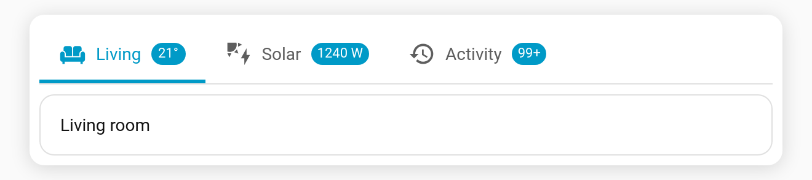

# Badges

A badge is a small piece of text shown on a tab — perfect for unread counts, alarm states, or "X on" summaries.

## Entity badge

Set `badge` to an entity id and the badge shows that entity's **state**:

```yaml
tabs:
  - name: Inbox
    icon: mdi:email
    badge: sensor.unread_count
    card: { ... }
```

## Template badge

Set `badge` to a Jinja template (anything containing `{{` or `{%`) and it is rendered live over the HA websocket:

```yaml
tabs:
  - name: Lights
    icon: mdi:lightbulb-group
    badge: >-
      {{ states.light | selectattr('state','eq','on') | list | count }}
    card: { ... }
```

## Count badge (no Jinja)

Count entities by pattern, without writing a template:

```yaml
tabs:
  - name: Lights
    icon: mdi:lightbulb-group
    badge:
      count: light.*              # one pattern or a list; * matches anything
      state: "on"                 # optional: a state or list of states
      area: living_room           # optional: only this area (device areas count)
    card: { ... }
```

- Without `state`, it counts entities that are **active** (on, open, home, playing, a number above 0, …).
- Patterns can be several: `count: [light.*, switch.*_lamp]`.
- Count badges are YAML; the visual editor keeps them when you edit other fields.

## Badge icon (`badge_icon`)

Show an icon as the badge instead of text:

```yaml
    badge: binary_sensor.washer_done
    badge_icon: mdi:check-bold      # shown while the badge is active
```

Without a `badge`, the icon is always shown, which is handy for marking a tab.

## More than one badge (`badges`)

A tab can show several badges side by side, for example a count, an alarm and a lock:

```yaml
tabs:
  - name: Security
    icon: mdi:shield-home
    badge: sensor.open_windows              # the main badge, as usual
    badges:
      - badge: binary_sensor.alarm_triggered
        icon: mdi:alert                     # shown while the alarm is on
        color: var(--error-color)
      - badge: "{{ is_state('lock.front_door', 'unlocked') }}"
        icon: mdi:lock-open-variant         # shown while the template is true
      - badge: "{{ states.light | selectattr('state','eq','on') | list | count }}"
        color: var(--warning-color)
      - icon: mdi:star                      # no badge: always shown
```

- Each `badge` works like the main one: an entity id, a template, a count (`{ count: light.*, state: "on" }`) or plain text.
- With an `icon`, the badge is that icon, shown while the value is active (not `0`/`off`/`closed`/`unavailable`…), or always when there's no `badge`.
- Text badges follow `hide_inactive_badge`, `badge_format` and `badge_display: dot` like the main badge.
- `color` colours that badge; the text turns black or white to stay readable.
- The list is YAML only; the visual editor keeps it when you edit other fields.

## Bounce on change (`badge_bounce`)

With `badge_bounce: true` (top level), a tab's badge jumps briefly when its value changes, so a new message or a rising count catches the eye:

```yaml
type: custom:tabdeck-card
badge_bounce: true
tabs:
  - name: Post
    icon: mdi:email
    badge: sensor.unread_mail
```

- It bounces once per change, including when a badge appears. Values that arrive while the page is loading don't bounce.
- A running `countdown` doesn't bounce every second.
- Nothing moves when the device asks for reduced motion (`prefers-reduced-motion`).

## Countdown badge (`countdown`)

Show the time left on a timer as the tab's badge:

```yaml
tabs:
  - name: Kitchen
    icon: mdi:pot-steam
    countdown: timer.pasta
    badge_color: var(--warning-color)
```

- While the timer runs, the badge counts down every second (`12:34`, or `1:02:05` over an hour). Paused, it shows the time left without ticking. Idle, the tab shows its normal `badge` (if any).
- An entity whose state is a time (for example a washer's "finished at" sensor with `device_class: timestamp`) counts down to that time.
- The deck only ticks while a countdown is running on a tab the bar shows and the page is visible.
- `badge_color`, `badge_action` and `badge_display: dot` work with it.

## Progress ring (`ring`)

Draw a ring around the tab's icon that fills with a value, such as a battery level or a washing machine's progress:

```yaml
tabs:
  - name: Washer
    icon: mdi:washing-machine
    ring: sensor.washer_progress   # entity id, template or number
    ring_max: 100                  # default 100
    ring_color: "#4caf50"          # optional
```

- Values are clamped to 0–`ring_max`; a non-numeric state (`unavailable`) shows no ring.
- Colours: `ring_color`, or the `--tabdeck-ring-color` and `--tabdeck-ring-track` variables.
- The ring needs the tab to show its icon. For tabs without one, use the bar below.

### Progress bar (`ring_style: bar`)

`ring_style: bar` shows the same value as a thin bar along the bottom of the tab instead of a ring, so it works on label-only tabs too:

```yaml
tabs:
  - name: Washer
    ring: sensor.washer_progress
    ring_style: bar
    ring_color: var(--success-color)
  - name: Printer
    ring: "{{ state_attr('sensor.printer', 'progress') }}"
    ring_style: bar
```

- `ring_max` and `ring_color` work the same as for the ring. A non-numeric value shows no bar.
- Variables: `--tabdeck-progress-height` (3px), `--tabdeck-progress-offset` (5px from the bottom), plus the ring's `--tabdeck-ring-color` and `--tabdeck-ring-track`.
- Screen readers hear it as a progress bar with the percentage.
- Use `tab_defaults: { ring_style: bar }` for every tab.

## Mini graph (`graph`)

A tiny line of one entity's recent history, drawn next to the tab's label:

```yaml
tabs:
  - name: Climate
    icon: mdi:thermostat
    graph: sensor.lounge_temperature        # last 24 hours
  - name: Power
    icon: mdi:flash
    graph:
      entity: sensor.house_power
      hours: 3                              # default 24
      color: var(--warning-color)           # default: the tab's text colour
```

- The entity needs a numeric state that the recorder keeps.
- The history is loaded once when the tab appears on the bar, then new states are added as they arrive; it is loaded again every 15 minutes. Graphs on tabs that aren't drawn (hidden tabs, `hide_bar`, `display: dots`, tabs outside `bar_limit`) load nothing.
- Size and colour: `--tabdeck-graph-width` (44px), `--tabdeck-graph-height` (12px), `--tabdeck-graph-color`.
- The visual editor has an entity picker for it; `hours` and `color` are YAML.

## Changed since you last looked (`changed_dot`)

With `changed_dot: true`, a small dot appears on any tab whose entities changed state while you were looking at another tab. Opening the tab clears it.

```yaml
type: custom:tabdeck-card
changed_dot: true
tabs:
  - name: Doors
    card:
      type: entities
      entities: [binary_sensor.front_door, binary_sensor.back_door]
  - name: Post
    watch: [binary_sensor.letterbox]   # only this entity counts
    card: { ... }
```

- The entities come from the tab's card: every `entity`, `entities` and `entity_id` in it, nested cards included. Area, floor and label tabs watch the entities they show.
- A tab's `watch` list replaces that, for a tab whose card has many entities but only one that matters, or a card (such as markdown) that names none.
- A change means the state changed (`last_changed`), such as `off` to `on`. Attribute updates, such as a new brightness, don't count.
- Each browser keeps its own record, so a wall tablet and your phone each show what you haven't seen there. The record survives a reload, so the dot also shows what changed while the dashboard was closed. Tabs you've never opened in that browser count from when the deck first loaded there.
- The dot uses the theme's accent colour. Set `--tabdeck-changed-color` (and `--tabdeck-changed-size`) in `styles` to change it.
- No dots show while the dashboard is being edited.
- In the visual editor, it's the **Dot on tabs that changed since you last looked** switch.

## Unavailable devices (`health_dim`)

With `health_dim: true`, a tab fades and shows a ⚠ when at least half of its entities are `unavailable`. A dead Zigbee room or a camera that's dropped off the network shows in the bar before you open the tab.

```yaml
type: custom:tabdeck-card
health_dim: true        # or a share, e.g. 0.75 for three quarters
tabs: [ ... ]
```

- The entities are the same ones `changed_dot` uses: everything named in the tab's card, or the tab's own `watch` list.
- An entity that no longer exists in Home Assistant counts as unavailable. `unknown` doesn't, because plenty of working sensors sit at `unknown`.
- Tabs with no entities (a markdown card, say) are never dimmed.
- The tab still opens normally; hover the ⚠ (or use a screen reader) for "Most of this tab's devices are unavailable".
- Change the look with `--tabdeck-unhealthy-opacity` (default `0.45`) and `--tabdeck-unhealthy-color` in `styles`.
- In the visual editor, it's the **Fade tabs whose devices are unavailable** switch (a share set in YAML is kept).

## Behaviour notes

- A plain string that is neither an entity id nor a template is shown verbatim.
- An empty or unresolved template renders no badge (rather than `unknown`).
- Template badges update automatically when their inputs change.

## Numeric formatting: `badge_format`

Numeric badges can be rounded, capped and given a unit. Set `badge_format` on a tab, or at the top level as a default for every tab (a tab's own `badge_format` wins).

| Key | Type | Effect |
| --- | --- | --- |
| `precision` | integer 0–6 | Round to this many decimal places (`21.456` → `21.5` with `1`). |
| `max` | number | Values above it show as `<max>+` (`150` → `99+` with `99`). |
| `unit` | string | Appended to the value (include a leading space if you want one: `" W"`). |

```yaml
type: custom:tabdeck-card
badge_format: { max: 99 }          # default: cap every count at 99+
tabs:
  - name: Living
    badge: sensor.living_room_temperature
    badge_format: { precision: 0, unit: "°" }
    card: { ... }
  - name: Solar
    badge: sensor.solar_power
    badge_format: { unit: " W", max: 9999 }
    card: { ... }
  - name: Activity
    badge: sensor.activity_count  # 485 → 99+ via the top-level default
    card: { ... }
```



- Non-numeric values (`on`, `Open`, …) are shown unchanged.
- With `badge_display: dot`, no text is shown, so formatting doesn't apply.
- Any numeric zero (`0`, `0.0`, `-0`) counts as *inactive*, so [`hide_inactive_badge`](Feature-Hide-Inactive-Badge) hides it and dot mode shows no dot.
