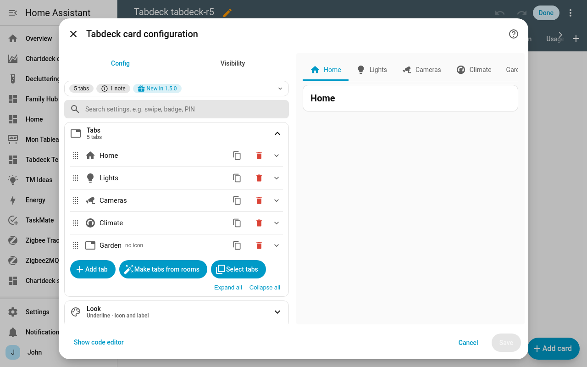
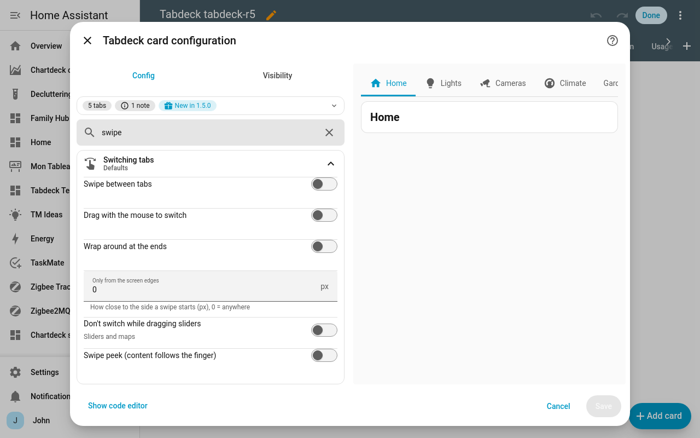
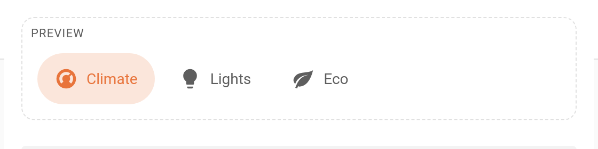
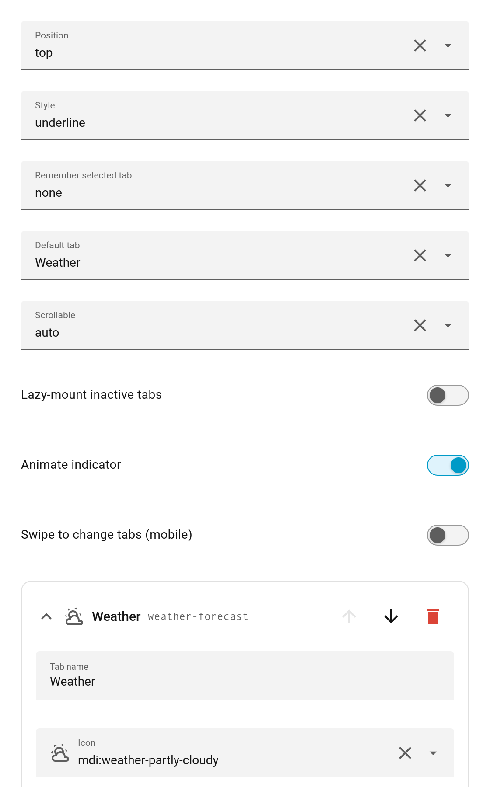
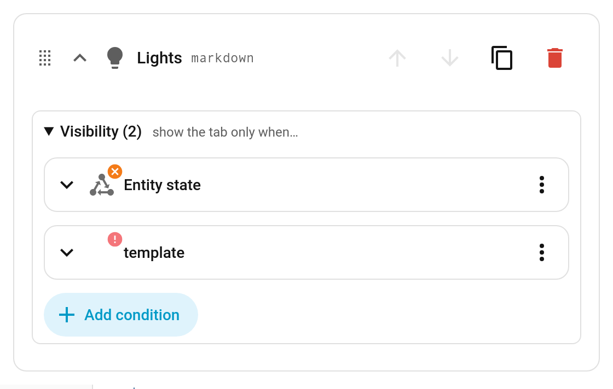
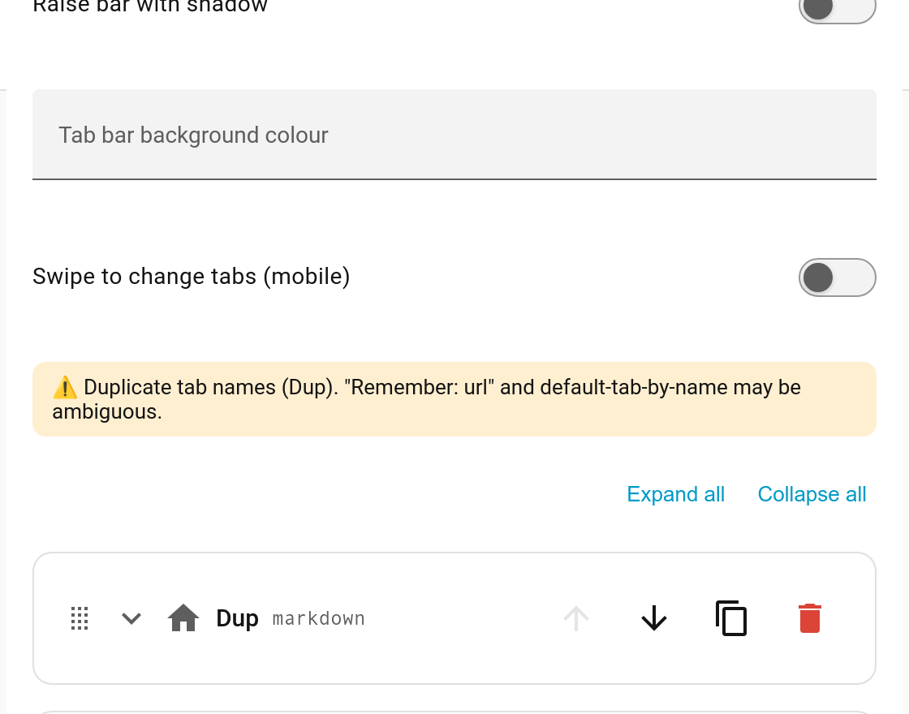
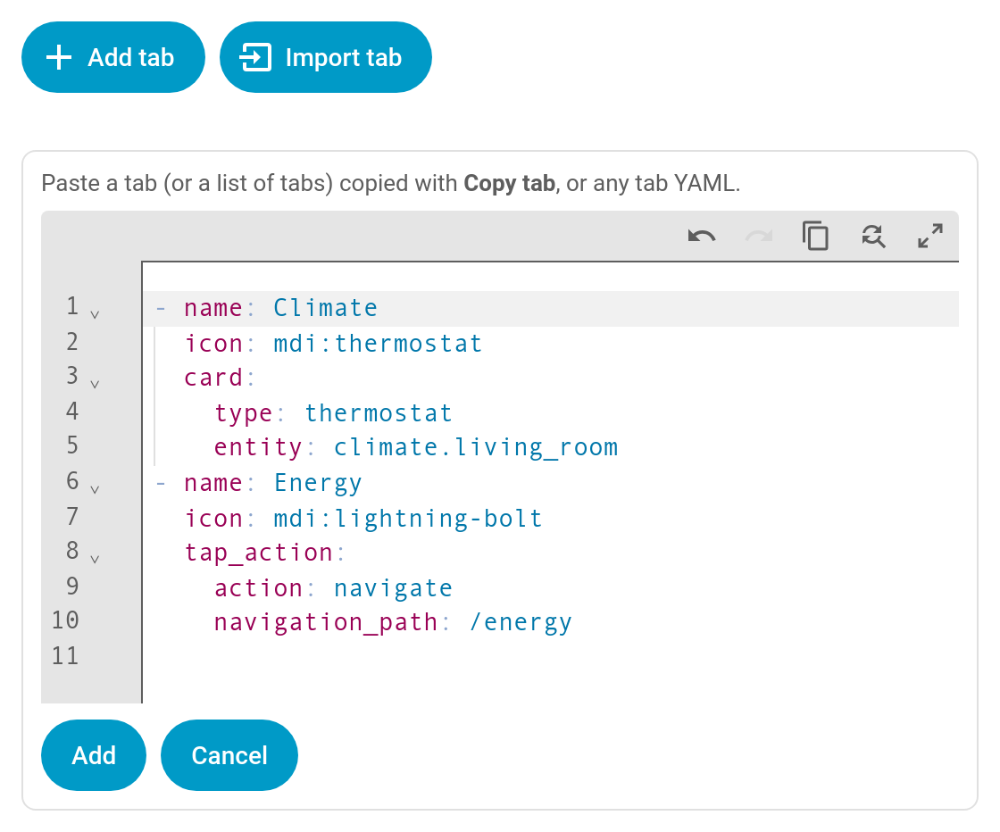

# The Visual Editor

Tabdeck ships a full GUI editor built on Home Assistant's own `ha-form`, so it matches your HA theme and version.

## Layout

From the top, the editor shows:

1. **A status line**: chips with the tab count, the number of config-check notes (amber when one is a warning) and **New in _version_** after an update. Tap it to open the [summary](#what-this-card-does), the [config check](#config-check) and [what's new](#whats-new); tap again to close.
2. **A search box** (see [Search](#search)).
3. **Tabs**, open by default: the tab list with **Add tab**, **Make tabs from rooms** and **Select tabs** under it.
4. Folding sections for the deck's settings. Each header has a second line saying what's set (for example *Underline · Icon and label*, or *Defaults*) and a dot when any setting in it differs from the default.

| Section | What's in it |
| --- | --- |
| Look | style preset, style, what tabs show (also when narrow), density, indicator, glass, shadow, bar colours, header title, content height, `split`, `scroll_spy` |
| Tab bar | position, orientation, alignment, scrolling, scroll buttons, ⋯ menu, `bar_limit`, sticky / autohide, dock, side rail, collapsible, wizard, breadcrumbs, `customize`, `drag_reorder`, `sort_by_usage` |
| Badges & alerts | badge style, hide at 0, bounce, alert chip, hidden alerts, `alert_first`, `alert_snooze`, `changed_dot`, `health_dim` |
| Switching tabs | swipe options, mouse wheel, transitions, keyboard shortcuts, content arrows, browser Back, quick-switch and dashboard search, overview, last-tab button, hold peek, compare, haptics |
| Start & memory | default tab, `remember` (and its entity / storage key), `learned_default`, `idle_return`, `scroll_memory` |
| Automations | `remote_entity`, `follow_room`, events, linked decks, popup, companion, usage stats |
| Wall tablet | screensaver, auto-rotate, click sound, fullscreen button, connection banner |
| Performance | `lazy`, `preload`, `unmount_hidden`, `unload_after`, loading boxes, friendly errors |
| Advanced | debug, edit-mode reveal, share button, bar name for screen readers, and the tools: **Import tab**, **Start from a template**, **Convert from another card**, **Import a style**, **Export as a dashboard view** |

Which sections are open is remembered per browser (`localStorage` key `tabdeck-editor-sections`); with site storage blocked they start closed each time (Tabs open). The visual editor still writes exactly the same YAML as before: only the layout changed.

## Search

Type in the search box to filter settings by their label, the hint under it, the option's YAML key (`swipe_edge`, `idle_dim`…) and its choices, in your Home Assistant language. Sections with a match open, the rest hide, and every word must match. The tab list filters too, by tab name and by its tags (*badge*, *PIN*, *no icon*), so **pin** finds tabs with a PIN. When nothing matches the editor says so; options that only exist in YAML need the code editor. Clear the box with **×** and the sections go back to how you had them.

## What's new

After an update, the status line shows a **New in _version_** chip; open the status line for the **New in Tabdeck _version_** note: a sentence on what changed and a **Read more** link to that version's release notes on GitHub. Press **×** and it stays away until the next release that has a note. The dismissal is stored in the browser (`localStorage` key `tabdeck-whats-new`), so each browser shows the note once; in a private window or with site storage blocked it shows each time the editor opens.

## Live preview

A **Preview** strip at the top of the Tabs section shows the tab bar with your current tabs, icons, accents, style, display mode and alignment — it updates live as you edit. When the dialog is wide enough for Home Assistant to show its own card preview beside the editor, the strip hides (the two would show the same thing); on a narrow dialog or a phone, where Home Assistant puts its preview under the whole editor, the strip stays.

### What this card does

In the status line, a **What this card does** box sums the deck up in plain sentences, in your Home Assistant language, for example:

> This deck has 5 tabs: Home, Lights, Cameras, Garage, and Settings. It opens on Lights. Each browser comes back to the tab it had open last. Garage only shows up some of the time. Cameras pulses when it needs attention. Lights shows a badge. Garage needs a PIN. Settings runs an action instead of opening. Swipe left or right to move between tabs. After 300 seconds without a touch it goes back to Lights. When Doorbell triggers, it shows Cameras for 45 seconds, then goes back.

It covers the tabs (up to six names; with more, the first five and "…"), `auto_tabs`, `default_tab` and `default_if`, `remember`, tabs with `visibility`, `alert`, a badge or ring, a `pin` or a `tap_action`, `swipe` / `swipe_mouse`, `auto_rotate`, `idle_return`, `remote_entity`, `remote_event`, `follow_room`, `takeover`, `quiet_hours` and `lazy`. Entities are named by their friendly name. It updates as you edit.

### Click to edit

Click a tab in the preview to jump to its settings. This works in the editor's own preview strip and in the card preview Home Assistant shows next to the editor: the Tabs section opens if it was folded, a search is cleared, the tab's row opens (others close), the editor scrolls to it and outlines it for a moment. If you were inside a tab's card editor, it goes back to the tab list first.

Only the editor in the same dialog reacts, and only when the clicked deck has the same tabs, so other decks on the dashboard behind the dialog (or a deck nested inside a grouped tab) don't move it. The card sends a `tabdeck-edit-tab` event (`detail: { index, names }`) whenever a tab is clicked in edit mode or the editor preview.

## Undo and redo

Every change in the visual editor can be undone, up to the last **50** steps.

- After the first change, **undo** and **redo** buttons appear pinned to the top of the editor, with a line naming the last change (for example *Removed tab "Garden"*).
- **Ctrl+Z** undoes and **Ctrl+Shift+Z** (or **Ctrl+Y**) redoes while the editor has focus (⌘ on a Mac). Inside a text box these keys belong to the box, so they undo your typing there instead.
- Typing in a field counts as one step (changes less than a second apart are joined).
- Changes made in **Show code editor** are steps too, so you can switch back and undo them.
- The history lasts while the dialog is open; it starts empty each time you open the editor.

## Global options

The sections expose the [top-level options](Configuration#top-level-options) the visual editor supports, each setting in exactly one section. Labels are short; where a setting needs a word more (units, "0 = off", what it needs), a hint line sits under it.

## Per-tab blocks

Each tab is a compact row: drag handle, icon, name, short tags (*badge*, *PIN*, *no icon*, and *hidden* / *alert* when its conditions say so), then **duplicate**, **delete** and the expand chevron. Rows start **collapsed**. Click a header (or focus it and press <kbd>Enter</kbd>/<kbd>Space</kbd>) to expand it and edit:

- **Tab name**
- **Icon** — HA's searchable icon picker with live previews
- **Accent colour**
- **Badge** — entity id or template
- **Actions** — tap / long-press / badge / enter / leave actions via HA's action picker
- **Visibility**, **Alert**, **Default when** — condition builders (see below)
- **Edit card** — drills into HA's native card editor (visual + YAML)

An expanded row starts with the tab's card type and **move up**, **move down** and **copy tab** buttons.

### Icon suggestions

If the tab's name says what the tab is, a **Suggested icons** row appears at the top of its settings, for example 🍴 stove, fridge, steaming pot and coffee for *Kitchen*. Click one to use it (the one in use is highlighted). The row follows the name as you type.

The keywords cover rooms (kitchen, living room, bedroom, bathroom, garage, garden, office, kids' room, hall, laundry, dining room, basement, attic, guest room, pool, gym) and topics (lights, heating, temperature, cooling, cameras, security, alarm, doors, locks, windows, blinds, energy, water, weather, TV, music, vacuum, calendar, family, plants, pets, car, home, settings, network, battery, chores, shopping, bins, fan, air, printer, updates, notifications) in English, German, Spanish, French, Italian, Dutch, Polish and Portuguese. Compound words work (*Kinderzimmer*), accents don't matter (*Küche* = *Kuche*). Templated names get no suggestions.

### Condition builders

Below the tab's fields are three collapsible sections, each showing its condition count:

| Section | Edits | Meaning |
| --- | --- | --- |
| **Visibility** | `visibility` | Show the tab only when… ([Tab Visibility](Tab-Visibility)) |
| **Alert** | `alert` | Pulse the tab when… ([Alert pulse](Feature-Alert)) |
| **Default when** | `default_if` | Start on this tab when… ([Conditional default](Feature-Conditional-Default)) |

They use **Home Assistant's own condition editor**, the same one as a card's *Visibility* tab. You can add *Entity state*, *Entity numeric state*, *Screen*, *User*, *Time* and *And/Or/Not* groups visually, test each condition live, and reorder, duplicate or delete them. Tabdeck-only types such as `template` show as editable **YAML** inside the same list. Removing every condition removes the key.

If HA's condition editor isn't available (an unusual frontend build), the section falls back to a YAML editor, or failing that a JSON text box.

### Reordering, deleting, adding

Each row has a **drag handle** (the grip icon) — drag a tab to reorder it — plus **duplicate** and **delete**; **move up / move down** are inside the expanded row. Dragging is off while a search filters the list.

### Bulk edit

To give several tabs the same icon or colour, choose **Select tabs** (under the tab list). Each tab header gets a tick box and a panel opens above the list:

1. Tick the tabs (or use **All** / **None**). Ticking doesn't open the tab.
2. Fill in **Icon**, **Accent colour** and/or **Text/icon colour**. Empty fields are left as they are on each tab.
3. **Apply to selected** sets them on every ticked tab. It's one change, so one **undo** takes it back.

**Done** leaves select mode. Deleting, moving or duplicating a tab clears the ticks, since the positions change.

### Copy & import tabs

Move tabs between decks, or share them, without hand-editing YAML:

- **Copy tab** (the export icon in an expanded tab) copies that tab's full config to the clipboard. It works on plain-`http://` Home Assistant too, where browsers block the modern clipboard API.
- **Import tab** (in **Advanced**) opens a YAML box. Paste one tab, or a **list** of tabs, and press **Add**. The new tabs are appended and expanded. Anything that doesn't look like a tab (no `card`, `cards` or `tap_action`) is rejected with a message.

The copied text is JSON, which is valid YAML, so you can also paste it straight into a dashboard's YAML.

### Config check

When something in the config looks wrong, the status line counts the notes, and opening it shows a **Config check** list with one line per note. Notes about a setting or a tab have a **Show** link: it opens that setting's section (or the tab's row), scrolls to it and outlines it for a moment.

| Mark | Kind | Examples |
| --- | --- | --- |
| ⚠ | Settings that clash or point nowhere | `dock` with `wizard` (the wizard wins) or with `hide_bar`; `remember: entity` without `remember_entity`; a `default_tab` that matches no tab; a `takeover`, `follow_room` map target or `remote_entity` that would open a tab with a `pin` (automatic switches don't open PIN-locked tabs) |
| ⚠ | Unknown options (typos) | `bar_colour`, a tab's `colour`. The visual editor drops unknown options when you save, so fix them in the code editor first if they matter. |
| ⓘ | Options that do nothing without another | `swipe_lock` / `swipe_edge` without `swipe` or `swipe_mouse`; `swipe_peek` without `swipe`; `swipe_wrap` without swipe, `hotkeys` or `content_arrows`; `preload` without `lazy`; `start_collapsed` without `collapsible`; `event_id` without `fire_event` / `remote_event`; `transition_duration` / `transition_easing` without a `transition`; `alert_first` / `alert_snooze` / `hidden_alerts` when no tab has `alert`; a tab's `badge_color` without a badge, `ring_max` / `ring_color` / `ring_style` without `ring`, `pin_timeout` without `pin` |
| ◷ | Slow setups | 15 or more tabs without `lazy`; `preload: all` on such a deck; a tab's `auto_refresh` under a minute; more than 30 templates in tab fields |

`tab_defaults` count for every tab, and values the editor fills in by default (such as `transition_duration: 180`) are not flagged. The list updates as you edit and disappears when there's nothing to say. The checks run on the config as written, nested `children` tabs included.

### Warnings

The editor shows a warning when it spots a footgun, e.g. **duplicate tab names** (which make `remember: url` and default-tab-by-name ambiguous). The **Add tab** button under the tab list appends a new, typeless tab — its drill-in shows a **card-type chooser** so you can pick (or type) any card type, including `custom:` cards.

## Notes

- A newly added tab starts with no card type; choose one in the drill-in. The live preview shows a "No card type configured" placeholder until you do — this is expected and matches native HA.
- The editor never hard-codes HA element names; it uses `ha-form` selectors so it keeps working across HA frontend versions.
