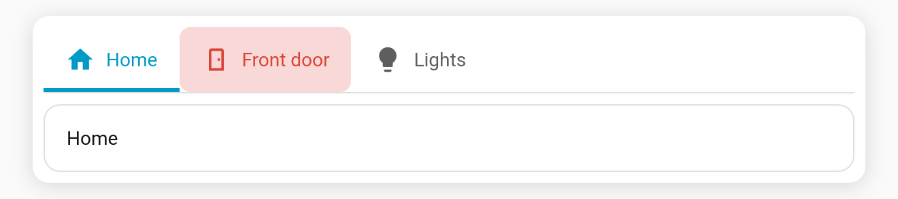

# Alert pulse

Give a tab **`alert`** conditions, and it **pulses** in the alert colour while they're met. This draws the eye to something that needs attention, like a door left open, a leak, or a freezer that's too warm, even when you're on another tab.

**Per-tab key:** `alert`, a list of conditions using the same syntax as [`visibility`](Tab-Visibility) (`state`, `numeric_state`, `screen`, `time`, `user`, `template`, `and`/`or`/`not`). All must be met.

```yaml
type: custom:tabdeck-card
tabs:
  - name: Home
    icon: mdi:home
    card: { ... }
  - name: Front door
    icon: mdi:door
    alert:
      - condition: state
        entity: binary_sensor.front_door
        state: "on"
    card: { ... }
  - name: Freezer
    icon: mdi:fridge
    alert:
      - condition: numeric_state
        entity: sensor.freezer_temperature
        above: -12
    card: { ... }
```



## "Open for more than 5 minutes"

Duration checks go through a `template` condition:

```yaml
alert:
  - condition: template
    value_template: >-
      {{ is_state('binary_sensor.front_door', 'on') and
         (now() - states.binary_sensor.front_door.last_changed).total_seconds() > 300 }}
```

> In the visual editor, use the tab's **Alert** condition builder. See [The Visual Editor](Editor#condition-builders).

## Alerting tabs first (`alert_first`)

With **`alert_first: true`**, tabs whose alert is active move to the front of the bar, keeping their order among themselves, and go back when the alert clears. The selected tab stays selected.

## Snooze (`alert_snooze`)

**`alert_snooze: 30`** lets you **long-press** an alerting tab to silence its pulse for 30 minutes. The snooze is per browser and ends early when the alert clears, so the next alert pulses again. While `alert_snooze` is on, a long-press on an alerting tab snoozes it instead of running its `hold_action`.

## Styling

| Variable | Default | Effect |
| --- | --- | --- |
| `--tabdeck-alert-color` | `var(--error-color)` | Pulse tint and label/icon colour. |
| `--tabdeck-alert-radius` | `8px` | Corner radius of the pulse. |

Set them with [`styles`](Feature-Theming), e.g. `styles: { --tabdeck-alert-color: orange }`.

## Behaviour

- The tab keeps working normally (tap to select); the pulse is only visual.
- Under **reduced motion** the pulse becomes a steady tint.
- A per-tab [`color`](Feature-Tab-Color) overrides the alert's label/icon colour, but the tint still pulses.

## Alert count on the bar (`summary_chip`)

`summary_chip: true` puts a red chip at the end of the bar with the number of tabs that are alerting right now, such as **⚠ 3 alerts**. It's hidden while nothing is alerting. Clicking it opens the next alerting tab, so repeated clicks walk through them.

```yaml
type: custom:tabdeck-card
summary_chip: true
tabs: [ ... tabs with alert conditions ... ]
```

Your own text, icon and colour:

```yaml
summary_chip:
  text: "{n} to check"              # {n} = alerting tabs; hidden when it's 0
  icon: mdi:bell-ring
  color: var(--warning-color)
```

```yaml
summary_chip: "{{ states.light | selectattr('state','eq','on') | list | count }} lights on"
```

- A text without `{n}` (a template, say) shows whenever it isn't empty.
- Without `text`, the object form keeps the alert count and just changes the icon or colour.
- Variables: `--tabdeck-summary-background`, `--tabdeck-summary-color`.
- Snoozed tabs (`alert_snooze`) don't count while snoozed.
