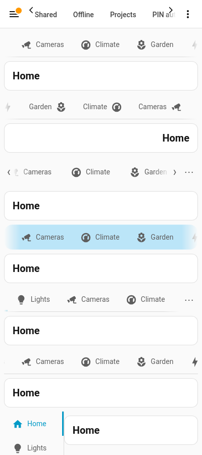

# Bar fade

When the tabs don't fit across the bar and it scrolls sideways, the edge that has more tabs beyond it fades out, so it's clear there's more to scroll to:

- at the start of the bar, only the end edge fades;
- in the middle, both edges fade;
- at the end, only the start edge fades.

When every tab fits, nothing fades. It follows the reading direction: with a right-to-left language (or `direction: rtl`) the start is on the right.

It's **on by default**. To turn it off:

```yaml
type: custom:tabdeck-card
bar_fade: false
tabs: [...]
```

In the visual editor it's **Fade the edges when tabs don't fit** in the **Tab bar** section.



## Notes

- It works with [scroll buttons and the ⋯ menu](Feature-Scroll-Buttons), `bar_limit`, sticky bars and every `style`.
- It's a mask over the whole bar, so on a bar with a background (`bar_background`, `glass`) the bar's colour fades at that edge too.
- Side bars (`position: left` / `right`) and the `dock` don't scroll sideways, so they never fade.
