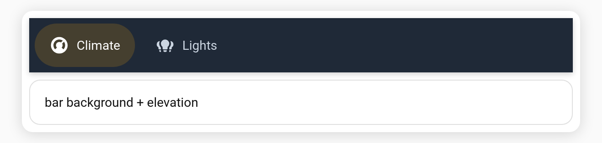

# Tab bar background & elevation

Give the tab bar its own surface — a custom background colour and/or a subtle drop shadow that lifts it off the card.

**Config keys:** `bar_background` (CSS colour) · `elevation` (boolean, default `false`)

```yaml
type: custom:tabdeck-card
style: pill
bar_background: "#1f2937"
elevation: true
tabs:
  - name: Climate
    icon: mdi:thermostat
    color: "#ffffff"          # readable text on the dark bar
    accent: "#f59e0b"
    card: { ... }
```



## Notes

- `bar_background` accepts any CSS colour (hex, `rgb()`, `var(--…)`).
- `elevation` adds `--tabdeck-bar-shadow` (default `0 2px 6px rgba(0,0,0,.18)`) — override it via [`styles`](Feature-Theming).
- Pair with per-tab [`color`](Feature-Tab-Color) so labels stay readable on a dark bar.
- Both are in the visual editor (**Tab bar background colour**, **Raise bar with shadow**).

## Readable text (`bar_text`)

A dark or busy `bar_background` can swallow the theme's grey tab text. **`bar_text: auto`** turns the labels, icons and bar buttons black or white, whichever reads better on the background:

```yaml
type: custom:tabdeck-card
bar_background: "center / cover url('/local/wood.jpg')"
bar_text: auto
tabs: [ ... ]
```

- It works for a colour, a gradient (the average of its colours) and a picture. A picture is drawn tiny in the background and averaged; the card shows straight away with the theme's colours and switches once that's done (a fraction of a second, then cached).
- When the accent colour would be hard to read on the background (under 3:1), the open tab's text follows too. The indicator keeps the accent.
- A picture from another site can only be read when that site allows it (CORS). If it can't be read, nothing changes. Set the colour yourself with **`bar_text: light`** (light text, for a dark background) or **`bar_text: dark`**.
- Translucent backgrounds (`glass`, `color-mix(…)`) can't be measured, because what shows through isn't known; use `light` / `dark` there.
- A tab's own `color` and `--tabdeck-selected-color` still win. `--tabdeck-tab-color` sets the colour of tabs that aren't open by hand.
- In the visual editor: **Tab text colour on the bar background**.

## Frosted glass (`glass`)

`glass: true` makes the bar frosted glass: a see-through tint of the card colour, a blur of whatever is behind it (the dashboard background, or content scrolling under a `sticky` bar), a thin light edge and rounded corners. It works with every `style`.

```yaml
type: custom:tabdeck-card
glass: true            # or a number: the blur in px (default 14)
style: pill
tabs: [ ... ]
```

- The menus, panels and tooltips that open from the bar are frosted too.
- A glass [`dock`](Feature-Dock) floats a few px above the bottom of the screen instead of sitting on a solid strip.
- `bar_background` becomes the tint, e.g. `bar_background: "rgba(20, 30, 50, 0.35)"` for a dark glass.
- Variables (set them in [`styles`](Feature-Theming)): `--tabdeck-glass-tint`, `--tabdeck-glass-blur`, `--tabdeck-glass-border`, `--tabdeck-glass-radius`, `--tabdeck-glass-shadow`. `--tabdeck-bar-backdrop` still replaces the whole filter.
- The blur only shows something when there is something behind the bar. Over a plain card colour it looks like a soft tinted bar. Browsers without `backdrop-filter` show the tint without the blur.
- `preset: glass` is unchanged; `glass: true` is the newer, fuller look and works with any preset.
- In the visual editor: **Frosted glass bar**.
