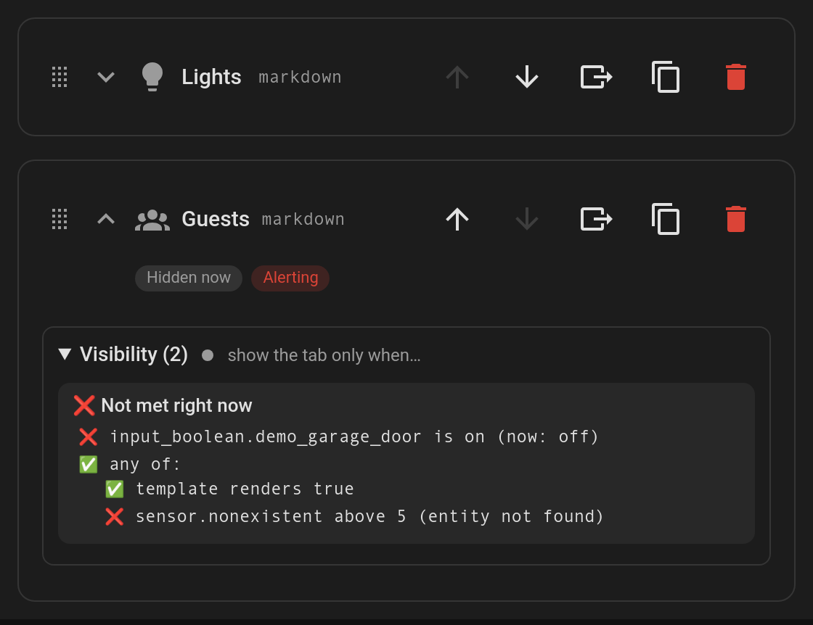

# Why is this tab hidden? (live condition check)

The visual editor checks every tab's conditions against your **live** Home Assistant state, so you don't have to guess why a tab isn't showing.

## What you get

- **Status chips** under each tab's header in the tab list:
  - **Hidden now**: the tab's `visibility` conditions aren't met, so it isn't on the dashboard right now.
  - **Alerting**: the tab's `alert` conditions are met, so it's pulsing.
- Each condition section (**Visibility**, **Alert**, **Default when**) has a dot in its title (green = met, grey = not met). Open it to see a breakdown with ✅ / ❌ for every condition, including nested `and` / `or` / `not` groups:
  - `state` and `numeric_state` show the entity's **current value**, e.g. `(now: off)`.
  - A misspelt or removed entity shows **entity not found**.
  - `template` conditions are rendered live by Home Assistant. They show *waiting for Home Assistant* until the first result arrives.
- Everything updates as states change, and the editor only redraws when a result actually changes.

No configuration is needed. While editing the dashboard, the card itself also shows hidden tabs (see [Edit mode helpers](Feature-Edit-Mode)).
