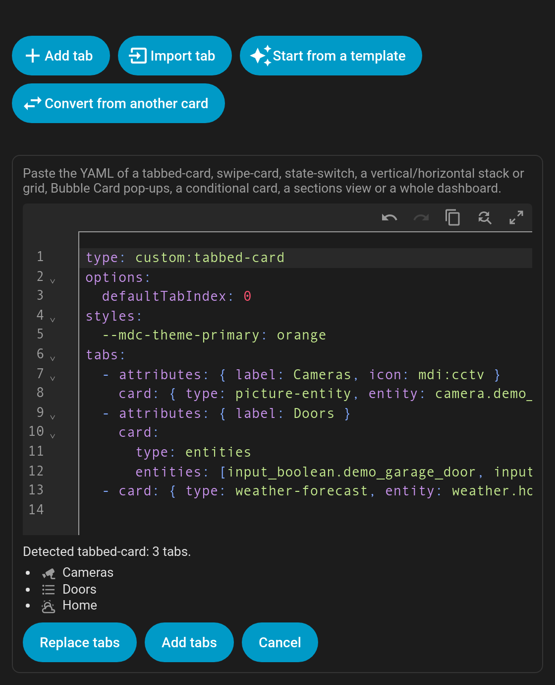

# Convert from another card

Already have a tabbed or swiping setup? Paste it into the editor and get a Tabdeck deck back.

Open the card editor, click **Convert from another card** and paste the YAML. The editor detects the format, lists the tabs it will create, and notes anything it couldn't carry over exactly. Then choose **Replace tabs** or **Add tabs**.

## Supported inputs

| Paste… | You get |
|---|---|
| **`custom:tabbed-card`** (kinghat) | One tab per tab, using `attributes.label` / `icon`. `options.defaultTabIndex` → `default_tab`; `--mdc-theme-primary` → `--tabdeck-accent`. |
| **`custom:swipe-card`** | One tab per card, with `swipe` and `swipe_mouse` on. `start_card` → `default_tab`, `loop` → `swipe_wrap`, `autoplay.delay` → `auto_rotate`. |
| **`custom:state-switch`** | One tab per state. For an entity, each tab gets `auto_select` on its state and the deck starts on the current state. `entity: hash` → `remember: url`. The `transition` is mapped. |
| **Bubble Card pop-ups** | A list of vertical stacks that each start with a `pop-up` → one tab per pop-up (name and icon from the pop-up, content from the rest of the stack). |
| **`vertical-stack` / `horizontal-stack` / `grid`** | One tab per card. If the stack has **`heading`** cards, each heading starts a tab holding the cards below it. |
| **`conditional`** cards | The inner card becomes the tab and the conditions become the tab's `visibility` (legacy `{entity, state}` conditions are upgraded). Cards with their own `visibility` keep it as tab visibility too. |
| **A sections view** | One tab per section, named by the section's heading card. |
| **A whole dashboard** (`views:`) | One tab per view, using the view's title and icon. |
| **A list of cards**, or **any single card** | One tab per card. |
| **A Tabdeck card or a list of tabs** | Passed through as-is. |

Tab names come from the card's `title` / `name` / `heading`, else the first entity's friendly name, else the card type. Icons come from the card's `icon`, else a sensible icon for the card type or entity domain.

**Replace tabs** also applies the carried-over options (`default_tab`, `swipe`, `transition`, …). **Add tabs** only appends the tabs.
