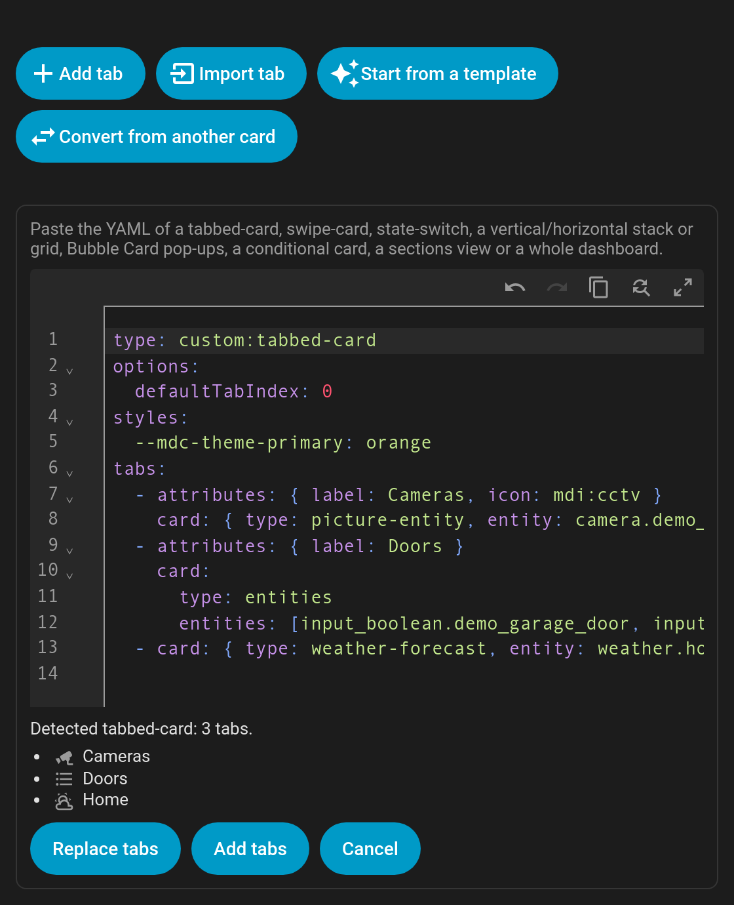

# Convert from another card

Already have a tabbed or swiping setup? Paste it into the editor and get a Tabdeck deck back.

Open the card editor, click **Convert from another card** and paste the YAML. The editor detects the format, lists the tabs it will create, and notes anything it couldn't carry over exactly. Then choose **Replace tabs** or **Add tabs**.



## Supported inputs

| Paste… | You get |
|---|---|
| **`custom:tabbed-card`** (kinghat) | One tab per tab, using `attributes.label` / `icon`. `options.defaultTabIndex` → `default_tab`; `--mdc-theme-primary` → `--tabdeck-accent`. |
| **`custom:swipe-card`** | One tab per card, with `swipe` and `swipe_mouse` on. `start_card` → `default_tab`, `loop` → `swipe_wrap`, `autoplay.delay` → `auto_rotate`. |
| **`custom:state-switch`** | One tab per state. For an entity, each tab gets `auto_select` on its state and the deck starts on the current state. `entity: hash` → `remember: url`. The `transition` is mapped. |
| **Bubble Card pop-ups** | A list of vertical stacks that each start with a `pop-up` → one tab per pop-up (name and icon from the pop-up, content from the rest of the stack). Stand-alone pop-ups (Bubble Card 3), in a list or a sections view, work too: the cards after a pop-up, up to the next one, are its tab. A pop-up without a `name` / `icon` takes them from a **horizontal buttons stack** (`1_link: "#kitchen"`, `1_name`, `1_icon`) or a **Mushroom chip** that opens it, else the name comes from the hash. Other cards outside the pop-ups are left out, with a note. |
| **`custom:mushroom-chips-card`** used as navigation | One tab per chip that does something a tab can: a chip that navigates to a view (`navigation_path: /dashboard/view`) becomes a [`view:` tab](Feature-Content-Shortcuts) showing that view's cards; a chip with a `url` action becomes an action tab. Names come from the chip's `name` / `content` (not templates) or the entity, else the last part of the path; icons from the chip's `icon`. A `conditional` chip's conditions become the tab's `visibility`. Chips that do neither (entity, back, menu…) are left out. A chips card with no such chip stays an ordinary card tab. |
| **`vertical-stack` / `horizontal-stack` / `grid`** | One tab per card. If the stack has **`heading`** cards, each heading starts a tab holding the cards below it. |
| **`conditional`** cards | The inner card becomes the tab and the conditions become the tab's `visibility` (legacy `{entity, state}` conditions are upgraded). Cards with their own `visibility` keep it as tab visibility too. |
| **A sections view** | One tab per section, named by the section's heading card. |
| **A whole dashboard** (`views:`) | One tab per view, using the view's title and icon. |
| **A list of cards**, or **any single card** | One tab per card. |
| **A Tabdeck card or a list of tabs** | Passed through as-is. |

Tab names come from the card's `title` / `name` / `heading`, else the first entity's friendly name, else the card type. Icons come from the card's `icon`, else a sensible icon for the card type or entity domain.

**Replace tabs** also applies the carried-over options (`default_tab`, `swipe`, `transition`, …). **Add tabs** only appends the tabs.

## Export as a dashboard view

The other direction: **Export as a dashboard view** in the visual editor turns the deck into a Home Assistant **sections view**, with one section per tab. Each section starts with a heading (the tab's name and icon) followed by the tab's cards. Use it to try the same cards as a plain dashboard page, or to move off Tabdeck.

1. Open the deck in the visual editor and choose **Export as a dashboard view**.
2. **Copy YAML**.
3. In the dashboard you want it in, choose **Edit dashboard → ⋮ → Raw configuration editor** and paste it as a new entry under `views:`.

```yaml
title: Tabdeck
type: sections
max_columns: 4
sections:
  - type: grid
    cards:
      - type: heading
        heading: Lights
        heading_style: title
        icon: mdi:lightbulb
      - type: tile
        entity: light.kitchen
```

- A tab's `cards:` become separate cards in its section. A `layout: sections` tab keeps its own sections, and an area, floor or label tab becomes tiles of the entities it shows now.
- A tab's `visibility` conditions move to its section. Sections understand state, numeric state, screen and user conditions. Template and time conditions are copied, but the editor warns they won't work there.
- Action tabs with no card (`tap_action` only) are left out, and the editor lists them.
- Generated tabs (`auto_tabs`) aren't included, because they only exist while the deck runs.
- Tab names that are templates become "Tab 1", "Tab 2"…, because headings can't render templates.
- `tab_defaults` and `tab_templates` are applied first, so the export shows what the deck shows.
- The view's title is the deck's `aria_label`, or "Tabdeck".
