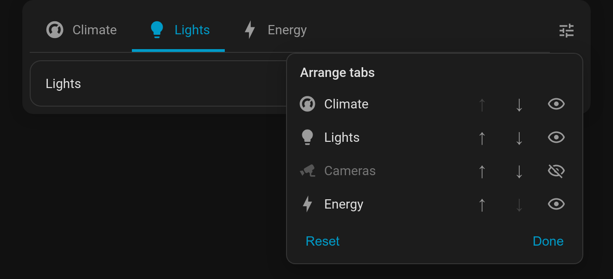

# Let people arrange their own tabs

With **`customize: true`**, the bar gets an **Arrange tabs** button (sliders icon). Anyone using the dashboard can then:

- **reorder** tabs with ↑ ↓, and
- **hide** tabs they don't need with the eye toggle.

Each person's arrangement is saved **in their browser** (by tab name), so it never changes the dashboard config or anyone else's view. **Reset** returns to the configured order. The last visible tab can't be hidden.

```yaml
type: custom:tabdeck-card
customize: true
tabs: [ ... ]
```



## Notes

- Tabs hidden by `visibility` conditions don't appear in the panel. The conditions still decide what's *available*; the person only arranges what they're allowed to see.
- Tabs added to the config later appear after the ones the person has already placed.
- While you **edit the dashboard** the button is hidden and every tab shows in config order (see [Edit mode helpers](Feature-Edit-Mode)).
- Per-browser storage means the arrangement on a wall tablet stays separate from the one on your phone. Each deck is keyed by its tabs and page; set `storage_key` if two identical decks need separate arrangements.

## Drag to reorder (`drag_reorder`)

With **`drag_reorder: true`**, people can rearrange tabs right on the bar: drag a tab and drop it where it should go. A line shows where it will land.

```yaml
type: custom:tabdeck-card
drag_reorder: true
tabs: [ ... ]
```

- **Mouse:** press on a tab and move it. A press without moving is still an ordinary click.
- **Touch:** hold the tab for a moment, then slide it. Sliding straight away scrolls the bar as usual.
- **Esc** cancels a drag in progress.
- The order is saved **in this browser**, in the same place as the `customize` order. Turn on `customize` as well to give people the **Arrange tabs** panel, which shows the dragged order, can hide tabs and has **Reset** to go back to the configured order.
- Tabs hidden by `visibility` conditions keep their place while you rearrange the others.
- A tab with a `hold_action` or `hold_peek` runs that on a touch hold that doesn't move. Hold and slide to drag it instead.
- Tabs without a `name` can't be dragged (the order is stored by name).
- The bar doesn't scroll by itself while you drag, so on a long scrolling bar drop the tab at the visible end and drag again.
- While you edit the dashboard dragging is off.

## Most-used tabs first (`sort_by_usage`)

With `sort_by_usage: true`, each browser counts how often each tab is opened and puts the most-opened tabs first. The wall tablet in the kitchen learns that Cameras and Lights get used, and your phone learns that you go straight to Heating.

```yaml
type: custom:tabdeck-card
sort_by_usage: true
tabs: [ ... ]
```

- The order is worked out when the page loads and stays put until the next load, so tabs never jump around while you're using them.
- Only tabs you open count. Automatic switches (`auto_rotate`, `idle_return`, `remote_entity`) don't.
- Tabs that have never been opened keep their configured order after the ones that have, and ties keep the configured order too.
- With `customize` on, the order a person sets in the Arrange tabs panel wins. Until they set one, the panel starts from the learned order.
- `separator` lines and spaces move with their tab.
- Keyboard shortcuts 1–9 follow the order on screen.
- Counts are kept by tab name in the browser's storage, keyed like `customize` (set `storage_key` to keep two identical decks apart).
