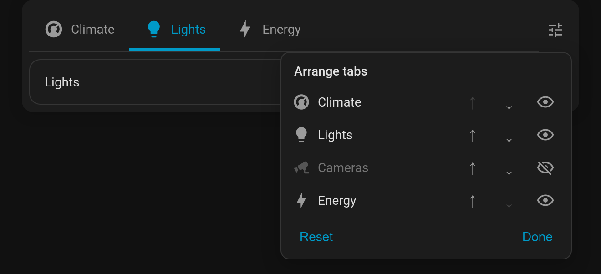

# Let people arrange their own tabs

With **`customize: true`**, the bar gets an **Arrange tabs** button (sliders icon). Anyone using the dashboard can then:

- **reorder** tabs with ↑ ↓, and
- **hide** tabs they don't need with the eye toggle.

Each person's arrangement is saved **in their browser** (by tab name), so it never changes the dashboard config or anyone else's view. **Reset** returns to the configured order. The last visible tab can't be hidden.

```yaml
type: custom:tabdeck-card
customize: true
tabs: [ ... ]
```



## Notes

- Tabs hidden by `visibility` conditions don't appear in the panel. The conditions still decide what's *available*; the person only arranges what they're allowed to see.
- Tabs added to the config later appear after the ones the person has already placed.
- While you **edit the dashboard** the button is hidden and every tab shows in config order (see [Edit mode helpers](Feature-Edit-Mode)).
- Per-browser storage means the arrangement on a wall tablet stays separate from the one on your phone. Each deck is keyed by its tabs and page; set `storage_key` if two identical decks need separate arrangements.
