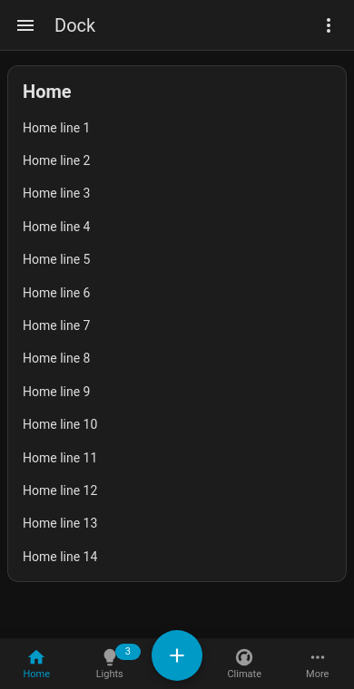

# Dock (bottom navigation) & floating action tabs

## Dock

**`dock: true`** turns the tab bar into a phone-style **bottom navigation bar**, pinned to the bottom of the screen. Each tab shows its icon above a small label, badges sit on the icon, and the content gets padding so the last card isn't hidden behind the bar.

```yaml
type: custom:tabdeck-card
dock: true
tabs:
  - { name: Home, icon: mdi:home, card: { ... } }
  - { name: Lights, icon: mdi:lightbulb, badge: "{{ states.light | selectattr('state','eq','on') | list | count }}", card: { ... } }
  - name: Add
    icon: mdi:plus
    fab: true
    tap_action: { action: navigate, navigation_path: /dashboard-shopping }
  - { name: Climate, icon: mdi:thermostat, card: { ... } }
  - { name: More, icon: mdi:dots-horizontal, card: { ... } }
```



- The dock spans the dashboard area (it follows HA's sidebar as it opens and closes) and respects the phone's safe area (home indicator).
- While you **edit the dashboard** the dock becomes a normal bar inside the card, so it never covers HA's edit controls.
- Use one docked deck per view. It works best as a view's only card, or in a **panel** view.
- Theme it with `--tabdeck-dock-background`, `--tabdeck-dock-shadow`, `--tabdeck-dock-tab-height` (56px) and `--tabdeck-dock-font-size` (11px).

## Floating action tabs

**`fab: true`** on a tab renders it as a raised, round accent-coloured button. In a dock it floats above the bar (put it in the middle). Usually it's paired with a `tap_action`, which runs an action (navigate, more-info, a script…) instead of opening a panel. A FAB tab with a card works like any other tab.

Colour it with `--tabdeck-fab-color` and size it with `--tabdeck-fab-size`. It works in any bar, not only the dock.

**Config keys:** `dock` (boolean, default `false`), per-tab `fab` (boolean). Both are toggles in the visual editor.
