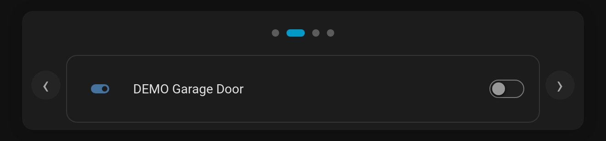

# Pagination dots & content arrows

Two options for carousel-style decks: slideshows, wall panels and "swipe through my rooms" cards.

## Dots

**`tab_display: dots`** replaces the tab bar with a centred row of pagination dots. The current tab's dot stretches into a pill in the accent colour, and an alerting tab's dot turns red. Screen readers still hear each tab's name.

## Content arrows

**`content_arrows: true`** adds **‹ ›** buttons beside the content to step to the previous or next tab. They skip disabled and action tabs, disappear at the ends, and wrap around with `swipe_wrap: true`. The arrows sit in their own side gutters, so they never cover a card's switches or sliders.

```yaml
type: custom:tabdeck-card
tab_display: dots
content_arrows: true
swipe: true          # swipe on phones too
swipe_wrap: true
tabs: [ ... ]
```



**Theming:** `--tabdeck-dot-size` (8px), `--tabdeck-arrow-gutter` (40px), `--tabdeck-arrow-opacity` (0.7). Both options are in the visual editor (Tab display → *Dots*, and the *Previous / next arrows* toggle).
