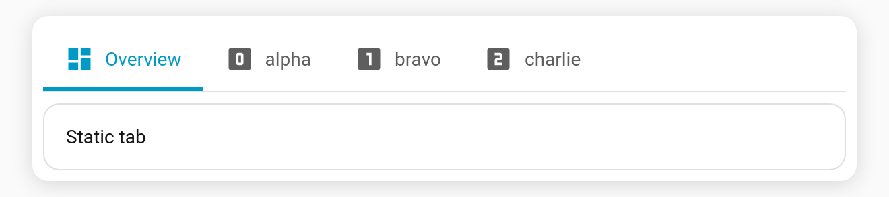

# Dynamic tabs (`auto_tabs`)

Generate a tab **per item** from live Home Assistant data instead of hand-writing them. Point a Jinja template at a list — entities in an area, every camera, a custom list — and Tabdeck builds one tab for each element, keeping them in sync as the list changes.

**Top-level key:** `auto_tabs`

```yaml
type: custom:tabdeck-card
tabs:
  - name: Overview            # static tabs still work; they stay first
    icon: mdi:view-dashboard
    card: { type: markdown, content: All cameras below }
auto_tabs:
  template: >                 # HA Jinja — must return a list
    {{ states.camera | map(attribute='entity_id') | list }}
  tab_template:               # blueprint filled once per list item
    name: "{{ item }}"
    icon: mdi:cctv
    card:
      type: picture-entity
      entity: "{{ item }}"
```

## Built-in sources: a tab per area, floor, label, domain, device, list, calendar, camera or zone

No Jinja needed. Set `source` and Tabdeck builds **one tab per Home Assistant area** (or one of the other sources below), each showing what belongs to it:

```yaml
type: custom:tabdeck-card
auto_tabs:
  source: areas            # or: labels
  domains: [light, switch, climate]   # optional: only these entity domains
  exclude: [garage]        # optional: area / label ids to skip
```


- Membership comes from HA's own `area_entities()` / `label_entities()`, so entities that belong to an area **through their device** are included, exactly as in HA.
- Areas or labels left with no matching entities are skipped.
- Areas use their **icon from the area registry** (falling back to `mdi:texture-box`). Labels use `mdi:label-outline`.
- Tabs follow HA's area / label order and update live when areas, labels or assignments change.
- Each item is `{ id, name, icon, entities }`, so you can supply your own `tab_template` instead of the default entities card. For example, HA's **area card**:

```yaml
auto_tabs:
  source: areas
  tab_template:
    name: "{{ item.name }}"
    icon: "{{ item.icon }}"
    card:
      type: area
      area: "{{ item.id }}"
```

- `source` replaces `template` (if both are set, `source` wins). The visual editor keeps the short `source` form in your YAML; the generated Jinja is never written out.

### All sources

| `source` | One tab per… | Default content |
| --- | --- | --- |
| `areas` | area (its registry icon) | entities card of the area's entities |
| `labels` | label | entities card of the labelled entities |
| `floors` | floor (its registry icon) | entities card of every entity in the floor's areas |
| `domains` | domain in `domains` (default: light, switch, climate, cover, fan, media_player, lock, camera, vacuum) | entities card of that domain's entities |
| `devices` | device (sorted by name; use `domains` to keep it short) | entities card of the device's entities |
| `todo` | to-do list | HA's to-do list card; the badge shows the open items |
| `calendars` | calendar | HA's calendar card (list view) |
| `cameras` | camera | picture-entity card of the camera |
| `zones` | zone | map of the zone and the people in it; the badge counts them |

- `domains` filters the entities of `areas`, `labels`, `floors` and `devices`; for `domains` it picks the domains.
- `exclude` takes area / floor / label / device ids, domains, or entity ids (`camera.doorbell`) for the per-entity sources.
- Each item has `id`, `name`, `icon` and, where it applies, `entities` and `count`, for your own `tab_template`.

### Tiles instead of a list: `content: tiles`

For `areas`, `floors` and `labels`, **`content: tiles`** gives each tab a grid of HA tile cards instead of an entities card:

```yaml
auto_tabs:
  source: floors
  content: tiles
  domains: [light, switch, climate]   # optional
```

## Area, floor and label tabs without a card (auto content)

A static tab with **`area`**, **`floor`** or **`label`** and no `card` fills itself with tile cards for every entity there, the way HA's own area dashboards do:

```yaml
tabs:
  - name: Kitchen
    icon: mdi:silverware-fork-knife
    area: kitchen               # or floor: ground_floor, or label: lights
    domains: [light, switch]    # optional: only these domains
```

- Entities placed in the area through their **device** are included; **hidden** entities and **config / diagnostic** ones are left out.
- The tab updates when entities are added, removed or moved in HA.
- With nothing to show, the tab says so instead of staying empty.
- The visual editor has an **Area** picker for this; `floor`, `label` and `domains` are YAML.

## Options

| Key | Type | Description |
| --- | --- | --- |
| `template` | string (Jinja) | **Required** unless `source` is set. Rendered by Home Assistant; must resolve to a **list**. Each element becomes a tab. |
| `source` | `areas` \| `labels` \| `floors` \| `domains` \| `devices` \| `todo` \| `calendars` \| `cameras` \| `zones` | Built-in source instead of `template` (see above), with optional `domains`, `exclude` and `content: tiles`. |
| `tab_template` | tab config | Optional blueprint. When present, it's filled once per list item using the placeholders below. When **absent**, each list element is used directly as a complete tab config. |

## Placeholders (inside `tab_template`)

| Placeholder | Resolves to |
| --- | --- |
| `{{ item }}` | The current list element (a string, or an object). |
| `{{ item.some.prop }}` | A dotted-path lookup when the element is an object, e.g. `{{ item.entity }}`. |
| `{{ index }}` | The 0-based position in the list. |

A placeholder that is the **whole** value keeps the resolved type (so `entity: "{{ item }}"` yields the item itself); a placeholder **inside** a larger string is interpolated as text (`name: "Cam {{ index }}"`).

### Items can be strings or objects

```yaml
auto_tabs:
  template: >
    {{ [
      {'label': 'Front',  'id': 'camera.front_door'},
      {'label': 'Drive',  'id': 'camera.driveway'}
    ] }}
  tab_template:
    name: "{{ item.label }}"
    card: { type: picture-entity, entity: "{{ item.id }}" }
```

### Template returns full tabs (no `tab_template`)

If you omit `tab_template`, the list elements are treated as ready-made tab configs:

```yaml
auto_tabs:
  template: >
    {{ [
      {'name': 'Lights', 'icon': 'mdi:lightbulb', 'card': {'type': 'light', 'entity': 'light.lounge'}},
      {'name': 'Climate', 'card': {'type': 'thermostat', 'entity': 'climate.hall'}}
    ] }}
```

## Behaviour

- **Static first, generated appended.** Existing `tabs:` keep working untouched; generated tabs are added after them. You can also use `auto_tabs` with **no** static `tabs` at all.
- **Live refresh.** When the template result changes (an entity appears/disappears), the tab set rebuilds automatically. Your current tab is preserved by **name** where possible, otherwise the position is clamped into range.
- **Two template layers, kept separate.** `auto_tabs.template` is rendered by Home Assistant. The `{{ item }}` / `{{ index }}` placeholders are resolved **inside the card** — and *only* those tokens. Any other `{{ ... }}` (for example a generated card's own `{{ states('sensor.x') }}` badge) is left untouched and rendered by Home Assistant as normal.
- **Empty / not-ready.** While the template is still rendering, errors, or doesn't return a list, no generated tabs are shown (and a deck with only `auto_tabs` simply shows nothing until the list arrives).
- **No cap.** Large lists are fine — combine with [`scroll_buttons` / `overflow_menu`](Feature-Scroll-Buttons) to handle a long bar.
- Configured in **YAML** (no visual-editor controls), like [`visibility`](Tab-Visibility) and [`auto_select`](Feature-Auto-Select).

## Example

A static **Overview** tab followed by one generated tab per item, with `{{ index }}` driving the icon:


