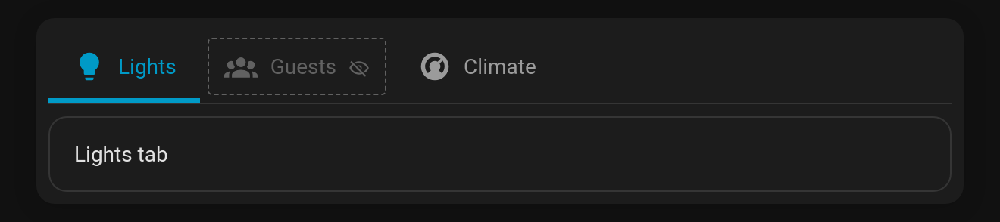

# Edit mode helpers

While you **edit the dashboard** (and in the card editor's live preview), Tabdeck shows the tabs that are normally hidden by their [visibility conditions](Tab-Visibility). They appear faded, with a dashed outline and an eye-off marker, so you can still open them and check their content. Once you leave edit mode they disappear again.

**Config key:** `edit_mode_reveal` (boolean, default `true`)



## Behaviour

- Hidden tabs are revealed only while Home Assistant reports edit mode (`editMode` / `preview`); a normal dashboard view is unchanged.
- **`auto_rotate` and `idle_return` pause** while editing, so the deck doesn't spin away from the tab you're working on. Their timers restart when you finish editing.
- Picks made while editing are **not remembered** (`remember: browser | url | entity`), because they may point at a tab that's hidden in normal use.
- Entering or leaving edit mode keeps you on the same tab where it still exists.
- Turn it off with `edit_mode_reveal: false` (also a toggle in the visual editor) to see exactly what your users see while editing.

```yaml
type: custom:tabdeck-card
edit_mode_reveal: false   # keep hidden tabs hidden, even while editing
tabs: [ ... ]
```
