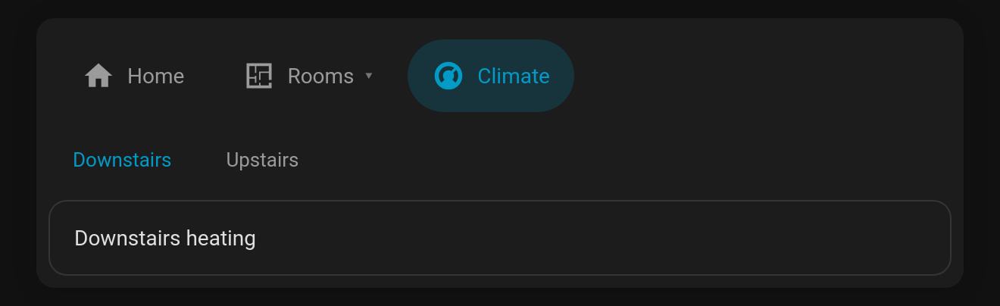
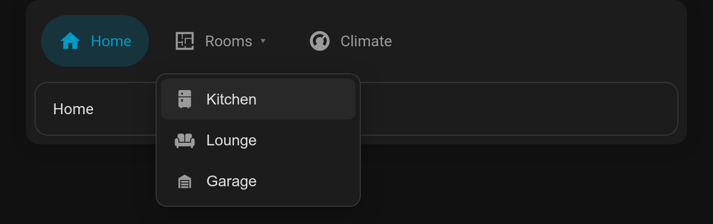

# Grouped tabs (sub-tabs & dropdown menus)

A tab can hold **its own tabs**. Give it `children:` (a list of ordinary tabs) instead of a `card`.

## Second-level row (default)

The children appear as a compact second row of tabs under the bar.

```yaml
- name: Climate
  icon: mdi:thermostat
  children:
    - { name: Downstairs, card: { ... } }
    - { name: Upstairs, card: { ... } }
```



## Dropdown menu

With `children_display: menu` the parent tab gets a **▾** and opens a menu of its children. Picking one opens it, and the parent tab's subtitle shows which child is open. The menu supports the keyboard: Enter/Space opens it, ↑ ↓ move, Esc closes.

```yaml
- name: Rooms
  icon: mdi:floor-plan
  children_display: menu
  children:
    - { name: Kitchen, icon: mdi:fridge, card: { ... } }
    - { name: Lounge, icon: mdi:sofa, card: { ... } }
    - { name: Garage, icon: mdi:garage, card: { ... } }
```



## Options

- **`children`**: a list of tabs. Each child supports every normal tab option (`visibility`, `badge`, `cards`, …).
- **`children_display`**: `row` (default) or `menu`.
- **`children_options`**: any Tabdeck card options for the inner deck, merged over the compact defaults (`style: text`, 36px tabs). For example, `children_options: { style: pill, remember: browser }`.

A grouped tab is a nested Tabdeck deck under the hood, so everything a deck can do works inside a group. In the visual editor, **Edit card** on a grouped tab opens the inner deck's editor, and your changes are saved back to `children`.

## Related: `hide_bar` and the public API

- **`hide_bar: true`** renders only the content, with no tab bar. The menu mode uses it, and it's handy for a deck that's driven by `remember: entity`, `auto_select` or a script.
- Every Tabdeck card exposes **`selectTab(nameOrIndex)`** (returns `true`/`false`; names match exactly or by slug, e.g. `living-room`) and **`selectedTab`** (the active tab's name). It also fires a **`tabdeck-tab-changed`** event (`detail: { index, name, deck }`, bubbling and composed) whenever the active tab changes. Use these from browser_mod, custom cards or your own JavaScript.
