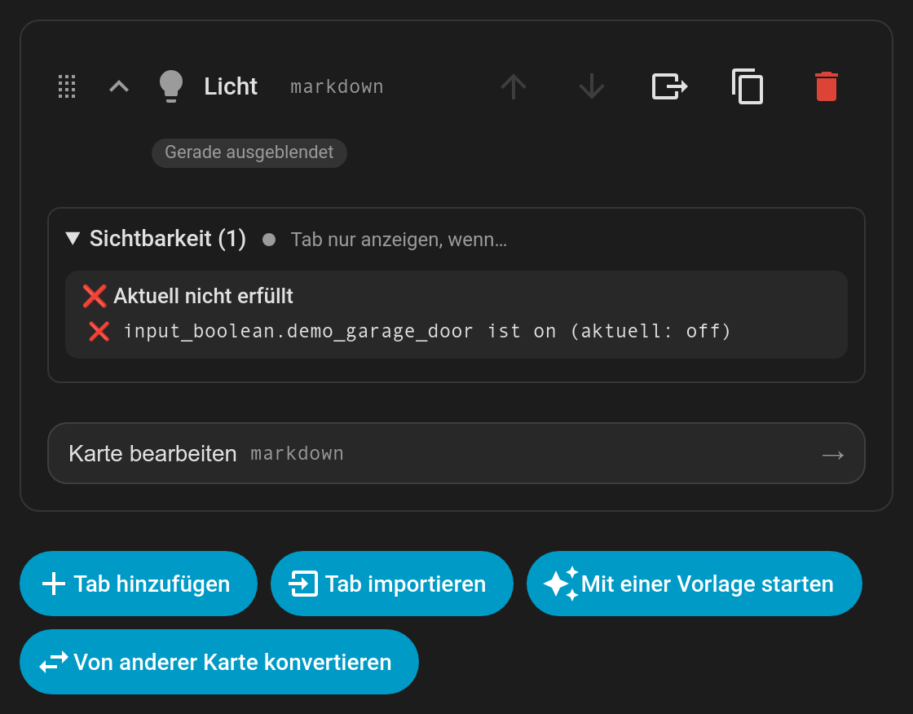

# Languages

Tabdeck's visual editor and the card's built-in text (accessible labels, the overflow menu, edit-mode hints) follow your **Home Assistant language** (Profile → Language). No configuration is needed.

| Language | Code |
|---|---|
| English | `en` |
| Deutsch | `de` |
| Español | `es` |
| Français | `fr` |
| Italiano | `it` |
| Nederlands | `nl` |
| Polski | `pl` |
| Português | `pt` (also used for `pt-BR`) |
| العربية (Arabic) | `ar` |
| বাংলা (Bengali) | `bn` |
| हिन्दी (Hindi) | `hi` |
| Bahasa Indonesia | `id` |
| 日本語 (Japanese) | `ja` |
| 한국어 (Korean) | `ko` |
| Русский (Russian) | `ru` |
| Türkçe | `tr` |
| Українська (Ukrainian) | `uk` |
| Tiếng Việt | `vi` |
| 简体中文 (Simplified Chinese) | `zh-Hans` |
| 繁體中文 (Traditional Chinese) | `zh-Hant` (also used for `zh-HK`) |

The twelve languages after Português were machine-translated; corrections from native speakers are very welcome.

Each language other than English is a small separate file that loads the first time it's needed, so the card only downloads the language you use.

Regional variants fall back to their base language (`de-CH` → `de`). Anything not translated yet falls back to English.



Your own tab names, subtitles and badges are never translated; they're shown exactly as you wrote them. The tab names that [starter templates](Feature-Starter-Templates) create are in your language.

## Right-to-left languages

When Home Assistant is set to a right-to-left language such as Arabic or Hebrew, the deck lays out right to left: the first tab is on the right, the indicator, badges and menus follow, and the arrow keys, swipes, the scroll buttons and `content_arrows` turn round, so **←** and a swipe to the right go to the next tab. A `position: left` (or `rail`) bar sits on the right, at the start of the line, and `right` on the left. The slide transitions and `swipe_peek` move the other way too.

Tabdeck reads the direction from HA's language (and from the page's `dir`). To force it, for example for a Hebrew deck on an English dashboard:

```yaml
type: custom:tabdeck-card
direction: rtl          # or ltr
tabs: [ ... ]
```

The cards inside the deck follow the same direction. Hotkeys `[` and `]` keep their meaning (previous / next).

## Help translate

The easiest way is **[Tabdeck on Hosted Weblate](https://hosted.weblate.org/projects/tabdeck-card/)**: pick your language, fix or confirm texts in the browser, and Weblate sends them to the project as a pull request. Most non-English texts started as machine translations, so a native speaker marking them as checked helps a lot.

There are two parts: **card** (what the dashboard shows, keep it short) and **editor** (the visual editor). Keep every `{placeholder}` as it is, keep the `one:` / `other:` labels in plural texts (`one:{n} tab|other:{n} tabs`; your language can add `few:` / `many:`), and leave config keys (`tap_action`, `input_number`, …) untranslated. Please use the same words Home Assistant's own frontend uses in your language (card, entity, helper, area, …).

To do it in the code instead: the texts live in [`src/translations/`](https://github.com/tempus2016/tabdeck-card/tree/main/src/translations), one file per language, each a flat list of `"key": "text"` pairs. Edit the file, run `npm run i18n:export` (it updates the JSON copies in `i18n/` that Weblate uses) and `npm test` (it checks every key and placeholder), then open a pull request. A new language also needs a loader in `src/translations/card/index.ts` and `src/translations/editor/index.ts`, plus `src/translations/editor/full/<lang>.ts`; open an issue and it will be added. Details: [`i18n/README.md`](https://github.com/tempus2016/tabdeck-card/blob/main/i18n/README.md) and [CONTRIBUTING](https://github.com/tempus2016/tabdeck-card/blob/main/.github/CONTRIBUTING.md#translations).
