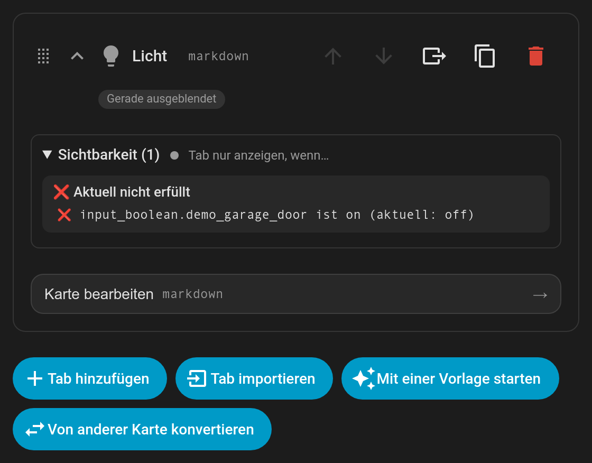

# Languages

Tabdeck's visual editor and the card's built-in text (accessible labels, the overflow menu, edit-mode hints) follow your **Home Assistant language** (Profile → Language). No configuration is needed.

| Language | Code |
|---|---|
| English | `en` |
| Deutsch | `de` |
| Español | `es` |
| Français | `fr` |
| Italiano | `it` |
| Nederlands | `nl` |
| Polski | `pl` |
| Português | `pt` (also used for `pt-BR`) |

Regional variants fall back to their base language (`de-CH` → `de`). Anything not translated yet falls back to English.

Your own tab names, subtitles and badges are never translated; they're shown exactly as you wrote them. The tab names that [starter templates](Feature-Starter-Templates) create are in your language.

## Help translate

Translations live in [`src/translations/`](https://github.com/tempus2016/tabdeck-card/tree/main/src/translations): one file per language, each a flat list of `"key": "text"` pairs. To add or improve a language:

1. Copy `en.ts` to `<code>.ts` (for example `sv.ts`) and translate the values. Keep every `{placeholder}` as it is, and leave config keys (`tap_action`, `input_number`, …) untranslated.
2. Register it in `src/lib/i18n.ts`.
3. Run `npm test`. A test checks that every key is present and every placeholder is kept.
4. Open a pull request.

Please use the same words Home Assistant's own frontend uses in your language (card, entity, helper, area, …).
