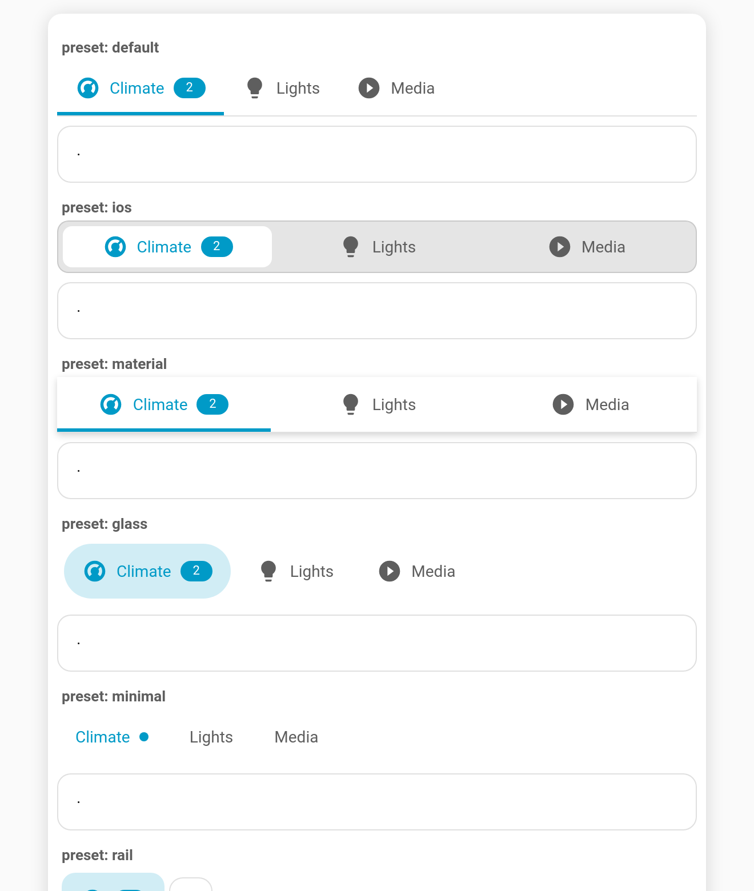

# Style presets

**`preset`** picks a ready-made look in one line. Each preset is a bundle of the existing styling options, so you can still override any of them.

**Config key:** `preset`: one of the names in the table below

```yaml
type: custom:tabdeck-card
preset: ios
tabs: [ ... ]
```



| Preset | What it sets |
| --- | --- |
| `default` | The stock look: `underline`, `start`-aligned, `both`. Handy in the editor to reset. |
| `ios` | `segmented` on a grey track, `justify`, 8 px radius, 36 px tabs. |
| `material` | `underline`, `justify`, `elevation`. |
| `glass` | `pill`, `sticky`, translucent frosted bar (`color-mix` background + `--tabdeck-bar-backdrop: blur(12px)`). |
| `minimal` | `text` style, labels only, dot badges. |
| `rail` | `position: left`, `rail` style, icons only. |
| `neumorphic` | Soft extruded look: an inset track and a raised, card-coloured selected tab (via `--tabdeck-bar-shadow` / `--tabdeck-indicator-shadow`). |
| `ha-tile` | Like HA's tile card: `boxed` chips with 12 px corners, 52 px tall, medium-weight labels. |
| `mushroom` | Mushroom-style chips: `pill`, 12 px corners, 40 px tall. |
| `bubble` | Bubble Card: a solid accent bubble on a soft track, readable text, an inverted badge on the selected tab. |
| `fluent` | Windows Fluent: a short rounded underline, 40 px, semi-bold labels. |
| `material-you` | Material You: a tonal pill in the theme's accent, `justify`, 40 px. |
| `material-expressive` | Inspired by Material 3 Expressive: a tall (56 px), fully rounded tonal bar with bold labels and a [liquid indicator](Feature-Indicator-Size#liquid-indicator-liquid_indicator). |
| `liquid-glass` | Inspired by liquid-glass phone UIs: a floating [frosted glass](Feature-Bar-Surface#frosted-glass-glass) capsule (blur 20 px) with a bright see-through selected lens that flows between tabs. Looks best over a dashboard background picture. |
| `accessible` | High contrast and large touch targets: 64 px tall tabs with a 2 px outline in the text colour, full-strength 16 px bold labels, 28 px icons, a solid yellow open tab with black text, and a 4 px focus ring. Follows light and dark themes. |

Every preset sets the same group of keys: `position`, `style`, `align`, `tab_display`, `badge_display`, `indicator_size`, `indicator_radius`, `elevation`, `sticky`, `bar_background`, `glass`, `liquid_indicator`, plus any preset `styles` variables.

The presets are original looks built from Tabdeck's own options. Names like Mushroom, Bubble, Material, Fluent or liquid glass describe the style they're inspired by; no code or artwork is taken from those projects.

## Overriding

In YAML, anything you set explicitly **wins over the preset**, and `styles` are merged:

```yaml
preset: glass
style: segmented                   # keep glass's frosted sticky bar, but segmented
styles:
  --tabdeck-accent: orange         # merged with glass's --tabdeck-bar-backdrop
```

## In the visual editor

**Style preset** is the first field. Choosing one **writes its values into the fields below** (so you can see and tweak them) and swaps any preset `styles` variables, while keeping your own. Afterwards, editing a field simply overrides it.

## New styling hook

`--tabdeck-bar-backdrop` sets a `backdrop-filter` on the bar (e.g. `blur(12px)`). When a sticky bar has a custom `bar_background`, the area behind it is now transparent, so translucent or blurred bars really show the content scrolling underneath.
