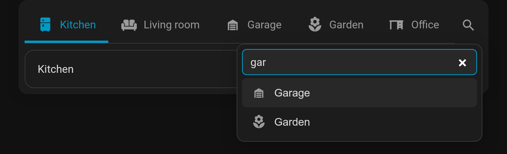

# Quick-switch search & keyboard shortcuts

For big decks (say 20 area tabs from `auto_tabs: { source: areas }`) and keyboard users.

## Search

**`search: true`** adds a 🔍 button at the end of the bar. It opens a filter box: type a few letters to narrow the tabs, use ↑ ↓ to move, **Enter** to open the highlighted tab and **Esc** to close.

- Matching ignores case and accents (`cafe` finds *Café*) and also searches subtitles.
- Disabled tabs are left out. Picking an action tab runs its action.



## Dashboard search (`entity_search`)

**`entity_search: true`** finds things by entity rather than by tab. Press **Ctrl+K** (**⌘K** on a Mac), or the search button at the end of the bar, and type part of an entity's name: *kitchen* lists **Kitchen light** on the Lights tab, **Kitchen temperature** on the Climate tab and so on. **Enter** or a tap opens that tab and scrolls the deck into view.

```yaml
type: custom:tabdeck-card
entity_search: true
tabs:
  - name: Lights
    card: { type: entities, entities: [light.kitchen, light.hall] }
  - name: Climate
    card: { type: thermostat, entity: climate.lounge }
```

- The entities come from each tab's card config, nested cards included, plus the tiles of `area` / `floor` / `label` tabs.
- Every word must match, in any order, in the friendly name or the entity id. Case and accents don't matter.
- An entity inside a grouped tab opens the child that shows it, such as **Rooms › Kitchen**.
- Several decks on one dashboard with `entity_search` are searched together; Ctrl+K opens the search on the first one that's on screen.
- Hidden tabs (their visibility conditions aren't met) and disabled tabs aren't searched. A PIN-locked tab asks for its code.
- The search only knows entities written in card configs. A card that picks its own entities (for example an auto-entities card) isn't found by them.

## Keyboard shortcuts

**`hotkeys: true`** enables page-wide shortcuts while the card is on screen:

| Key | Does |
|---|---|
| **1** – **9** | Open the 1st–9th visible tab |
| **[** / **]** | Previous / next tab (wraps with `swipe_wrap`) |
| **/** | Open search (needs `search: true`) |
| **o** | Open or close the [overview grid](Feature-Overview) (needs `overview: true`) |
| **l** | Back to the last tab (needs `last_tab_button: true`) |

Keys typed into text fields, keys with Ctrl/⌘/Alt, and decks that aren't visible (e.g. a nested deck in a closed tab) are ignored. If several decks on one view have `hotkeys` on, all of them respond, so enable it on one deck per view.

```yaml
type: custom:tabdeck-card
search: true
hotkeys: true
auto_tabs: { source: areas }
tabs: []
```

The arrow keys, Home and End already move between tabs whenever the tab bar has focus. That needs no option.
