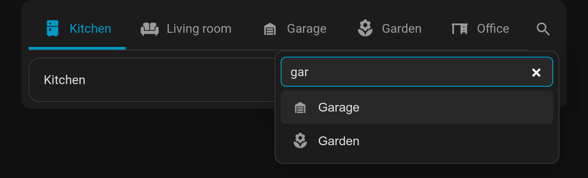

# Quick-switch search & keyboard shortcuts

For big decks (say 20 area tabs from `auto_tabs: { source: areas }`) and keyboard users.

## Search

**`search: true`** adds a 🔍 button at the end of the bar. It opens a filter box: type a few letters to narrow the tabs, use ↑ ↓ to move, **Enter** to open the highlighted tab and **Esc** to close.

- Matching ignores case and accents (`cafe` finds *Café*) and also searches subtitles.
- Disabled tabs are left out. Picking an action tab runs its action.



## Keyboard shortcuts

**`hotkeys: true`** enables page-wide shortcuts while the card is on screen:

| Key | Does |
|---|---|
| **1** – **9** | Open the 1st–9th visible tab |
| **[** / **]** | Previous / next tab (wraps with `swipe_wrap`) |
| **/** | Open search (needs `search: true`) |

Keys typed into text fields, keys with Ctrl/⌘/Alt, and decks that aren't visible (e.g. a nested deck in a closed tab) are ignored. If several decks on one view have `hotkeys` on, all of them respond, so enable it on one deck per view.

```yaml
type: custom:tabdeck-card
search: true
hotkeys: true
auto_tabs: { source: areas }
tabs: []
```

The arrow keys, Home and End already move between tabs whenever the tab bar has focus. That needs no option.
