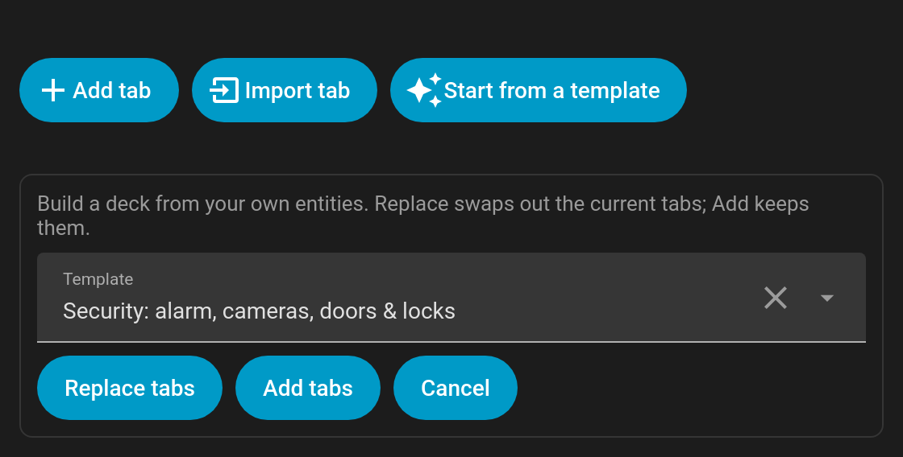

# Starter templates

New to Tabdeck? The editor can build a complete, working deck from **your own entities** in one click. Open the card editor, click **Start from a template**, pick one and choose:

- **Replace tabs**: swap out the current tabs for the template.
- **Add tabs**: keep your tabs and append the template's.



| Template | What it builds |
|---|---|
| **Rooms** | A tab per area, listing that area's entities (`auto_tabs: { source: areas }`, so new areas appear automatically). Turns on `scrollable` and the `overflow_menu`. |
| **Lights** | A tab per area that has lights (`auto_tabs: { source: areas, domains: [light] }`). |
| **Security** | **Alarm** (alarm panels; the tab pulses while `triggered`), **Cameras** (picture-entity cards in a 2-column grid), **Doors & windows** (door/window/garage/opening sensors, with a live count of open ones as the badge) and **Locks** (tiles). Tabs with nothing to show are skipped. |
| **Media** | A tab per media player (`media-control` card); the subtitle shows its state and TVs get a TV icon. Uses `tab_display: active`. |
| **Climate** | A tab per thermostat, with the current temperature as the badge (`badge_format: { precision: 1, unit: "°" }`). |
| **Energy** | The energy dashboard cards: distribution, usage graph, sources table and devices graph (requires the Energy dashboard to be set up). |
| **Family** | A tab per person, with their state as the subtitle and a tile plus a 12-hour map. |

If nothing matches (for example, **Media** with no media players), the editor says so and leaves your deck unchanged. Each deck is capped at 12 generated tabs.

Everything a template writes is ordinary Tabdeck config, so you can edit, reorder or delete the tabs afterwards. Tab names follow your Home Assistant language.


## Make tabs from rooms

**Make tabs from rooms** (next to *Start from a template*) builds static tabs from your areas, with a say in which ones:

1. The panel lists every Home Assistant area with how many entities it has (an entity's own area, else its device's; hidden, disabled, configuration and diagnostic entities don't count).
2. Rooms with entities start ticked, except rooms that already have a tab with that `area`. Tick or untick as you like.
3. **Create _n_ tabs** appends one tab per ticked room:

```yaml
- name: Kitchen
  icon: mdi:stove        # the area's icon, else mdi:texture-box
  area: kitchen
  card:
    type: entities
    title: Kitchen
    entities: [light.kitchen, sensor.kitchen_temperature]
```

The **Rooms** starter above uses `auto_tabs: { source: areas }` instead, which follows your areas as they change but can't be edited tab by tab. The room wizard writes ordinary tabs: change their cards, reorder them or delete the ones you don't need. New entities added to a room later are not added to its tab.

### A whole new dashboard from your rooms

**New dashboard with these rooms**, in the same panel, makes a **new** dashboard instead of adding tabs to the deck you're editing. It holds one panel view ("Rooms") with a deck that has a tab per ticked room, the same tabs as above. A link to it appears when it's done.

- It never changes an existing dashboard. It picks a dashboard address nobody uses (`tabdeck-rooms`, then `tabdeck-rooms-2`, …), creates the dashboard, checks it is still empty and only then saves the deck. If saving fails it removes the dashboard it just created.
- The deck you're editing isn't changed, and you can close the editor without saving.
- Only Home Assistant administrators can create dashboards. For other users the panel says so and nothing happens.
- Rename, move or delete the new dashboard in **Settings → Dashboards** like any other.
