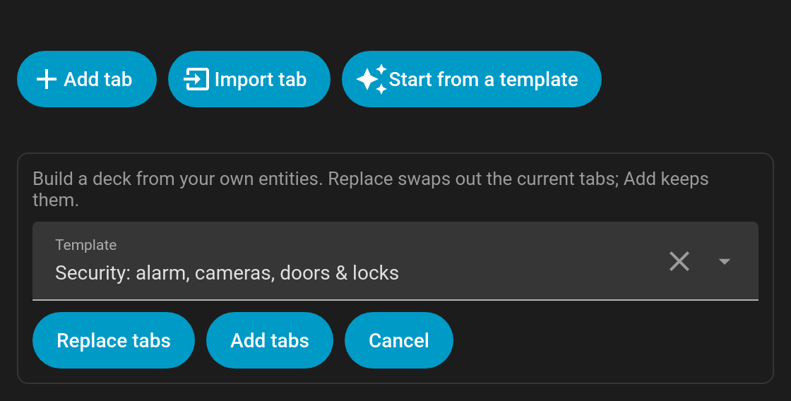

# Starter templates

New to Tabdeck? The editor can build a complete, working deck from **your own entities** in one click. Open the card editor, click **Start from a template**, pick one and choose:

- **Replace tabs**: swap out the current tabs for the template.
- **Add tabs**: keep your tabs and append the template's.

| Template | What it builds |
|---|---|
| **Rooms** | A tab per area, listing that area's entities (`auto_tabs: { source: areas }`, so new areas appear automatically). Turns on `scrollable` and the `overflow_menu`. |
| **Lights** | A tab per area that has lights (`auto_tabs: { source: areas, domains: [light] }`). |
| **Security** | **Alarm** (alarm panels; the tab pulses while `triggered`), **Cameras** (picture-entity cards in a 2-column grid), **Doors & windows** (door/window/garage/opening sensors, with a live count of open ones as the badge) and **Locks** (tiles). Tabs with nothing to show are skipped. |
| **Media** | A tab per media player (`media-control` card); the subtitle shows its state and TVs get a TV icon. Uses `tab_display: active`. |
| **Climate** | A tab per thermostat, with the current temperature as the badge (`badge_format: { precision: 1, unit: "°" }`). |
| **Energy** | The energy dashboard cards: distribution, usage graph, sources table and devices graph (requires the Energy dashboard to be set up). |
| **Family** | A tab per person, with their state as the subtitle and a tile plus a 12-hour map. |

If nothing matches (for example, **Media** with no media players), the editor says so and leaves your deck unchanged. Each deck is capped at 12 generated tabs.

Everything a template writes is ordinary Tabdeck config, so you can edit, reorder or delete the tabs afterwards. Tab names follow your Home Assistant language.
