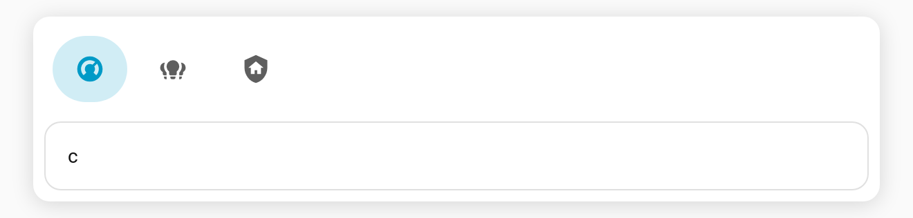

# Tab display mode

Choose whether the tab bar shows **icons, labels, or both** — or icons only, with the selected tab expanded to its name and subtitle. Great for compact bars on mobile or icon-driven dashboards.

**Config key:** `tab_display` (top-level) · **Values:** `both` (default) · `icon` · `label` · `active`

```yaml
type: custom:tabdeck-card
tab_display: icon      # both | icon | label | active
style: pill
tabs:
  - name: Climate
    icon: mdi:thermostat
    card: { type: thermostat, entity: climate.living_room }
  - name: Lights
    icon: mdi:lightbulb-group
    card: { type: entities, entities: [light.kitchen] }
  - name: Security
    icon: mdi:shield-home
    card: { type: entities, entities: [alarm_control_panel.home] }
```



## Behaviour

| Value | Shows |
| --- | --- |
| `both` | Icon **and** label (the classic look). |
| `icon` | Icon only — but a tab **with no icon** still shows its label, so a tab is never empty. |
| `label` | Label only; icons are hidden. |
| `active` | Icon only on unselected tabs; the **selected** tab shows its icon, name **and** subtitle. Tabs without an icon keep their label. |

Set it globally in the card config, or pick it from the **Tab display** dropdown in the [visual editor](Editor).

## Expand the selected tab (`active`)

Compact like `icon`, but the active tab spells out where you are — including its `subtitle`:

```yaml
type: custom:tabdeck-card
tab_display: active
style: pill
tabs:
  - name: Climate
    subtitle: 21.5 °C
    icon: mdi:thermostat
    card: { type: thermostat, entity: climate.living_room }
  - name: Lights
    subtitle: 3 on
    icon: mdi:lightbulb-group
    card: { type: entities, entities: [light.kitchen] }
  - name: Security
    subtitle: Armed
    icon: mdi:shield-home
    card: { type: entities, entities: [alarm_control_panel.home] }
```


The indicator follows the expanding tab as you switch.

## Tips

- Pair `tab_display: icon` with the `pill` or `segmented` [style](Configuration) for a clean app-style switcher.
- Give every tab an `icon` when using `icon` mode so the bar stays consistent.

> To switch display mode automatically on narrow cards, see [`tab_display_narrow`](Feature-Responsive#narrow-display-tab_display_narrow).
