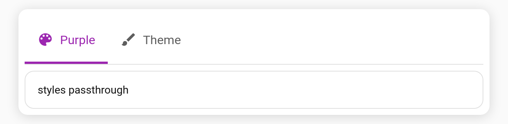

# Theming & the `styles` passthrough

Tabdeck reads several CSS custom properties and lets you set them (and any other CSS variables) directly from the card config via **`styles`** — no `card-mod` required.

**Config key:** `styles` (top-level map of CSS property → value)

```yaml
type: custom:tabdeck-card
styles:
  --tabdeck-accent: "#9c27b0"
  --tabdeck-tab-height: 64px
  --tabdeck-tab-font-size: 16px
tabs: [ ... ]
```



## Supported CSS variables

| Variable | Affects | Default |
| --- | --- | --- |
| `--tabdeck-accent` | Indicator / selected tab colour | `--primary-color` |
| `--tabdeck-tab-height` | Tab bar height | `48px` (see `density`) |
| `--tabdeck-tab-padding` | Padding inside each tab | `0 16px` (see `density`) |
| `--tabdeck-tab-font-size` / `-font-weight` / `-font-family` | Tab label font | `14px` / normal / theme font |
| `--tabdeck-tab-radius` | Corner radius of each tab | `0` |
| `--tabdeck-selected-color` | Selected tab's label / icon colour | accent (or automatic on a solid indicator) |
| `--tabdeck-indicator-color` | Fill of the moving indicator (any style) | the style's own |
| `--tabdeck-indicator-shadow` | Shadow of the indicator | none |
| `--tabdeck-badge-background` / `--tabdeck-badge-color` | Badge colours | accent / `--text-primary-color` |
| `--tabdeck-selected-badge-background` / `-color` | Badge colours on the selected tab | the badge colours |
| `--tabdeck-ring-color` / `--tabdeck-ring-track` | [Progress ring](Badges#progress-ring-ring) | accent / grey |

The card also honours standard HA theme variables (`--primary-color`, `--divider-color`, `--card-background-color`, `--secondary-text-color`, …).

## Theme colour names

Colour options (`accent`, `color`, `badge_color`, `ring_color`, `bar_background`) accept Home Assistant's **theme colour names** (`red`, `light-blue`, `amber`, `primary`, `accent`, …), the same ones HA's own cards use. A name becomes that theme's colour (`red` is `var(--red-color)`), so it follows your theme. Any other CSS colour (`#e91e63`, `rgb(…)`, `var(--my-color)`) works as written.

In the visual editor these fields use **HA's colour picker** while they're empty or hold a theme colour; a custom CSS value keeps a text field, so it's never hidden.

## Readable text and contrast

- On a **solid** fill (a `badge_color`, a floating action tab, or a pill / boxed indicator made solid with `--tabdeck-indicator-color`) the text switches to black or white, whichever reads better (WCAG contrast). Set `--tabdeck-selected-color` to choose yourself.
- The editor warns when a tab's `accent` or `color` has **low contrast** (under 3:1) with the current theme's card background.

## Density

**`density: compact`** (36 px tabs, tighter padding, 13 px labels) or **`density: comfortable`** (56 px, roomier, 15 px). Explicit `--tabdeck-tab-height` / `--tabdeck-tab-padding` / `--tabdeck-tab-font-size` still win.

## How `styles` works

- Each entry is applied as a custom property (or any CSS property) on the card host.
- Entries are reconciled on config change, so removing a key clears it.
- Per-tab [`accent`](Feature-Accent-Indicator) still overrides `--tabdeck-accent` for the selected tab.

> `styles` is YAML/advanced — it isn't shown in the visual editor, but it's fully supported and round-trips through the code editor.

> For one-line looks built from these options, see [Style presets](Feature-Presets). `--tabdeck-bar-backdrop` (e.g. `blur(12px)`) adds a frosted-glass `backdrop-filter` to the bar.

## Per-tab styles

A tab can carry its own **`styles`**. They're applied on top of the top-level `styles` **while that tab is active**, and removed when you switch away. Use them to give each tab its own accent, or to change any other variable per tab:

```yaml
type: custom:tabdeck-card
styles:
  --tabdeck-accent: "#1f6feb"        # default for every tab
tabs:
  - name: Security
    icon: mdi:shield-home
    styles:
      --tabdeck-accent: "#d93025"    # red while Security is open
    card: { ... }
  - name: Garden
    icon: mdi:flower
    styles:
      --tabdeck-accent: "#188038"
    card: { ... }
  - name: Other                      # falls back to the blue default
    card: { ... }
```

Unlike a tab's `accent` (which only colours that tab and the indicator), per-tab `styles` can change **anything** styled by a variable: bar background, tab height, alert colour and so on.
