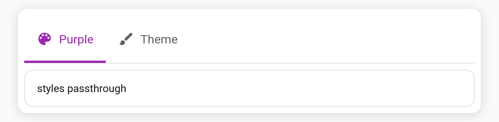

# Theming & the `styles` passthrough

Tabdeck reads several CSS custom properties and lets you set them (and any other CSS variables) directly from the card config via **`styles`** — no `card-mod` required.

**Config key:** `styles` (top-level map of CSS property → value)

```yaml
type: custom:tabdeck-card
styles:
  --tabdeck-accent: "#9c27b0"
  --tabdeck-tab-height: 64px
  --tabdeck-tab-font-size: 16px
tabs: [ ... ]
```



> 🎨 **[Theme builder](https://tempus2016.github.io/tabdeck-card/demo/theme.html)**: pick a preset, style, colours, density and font, watch a sample deck change, then copy the YAML into your card. It runs in the browser, with no Home Assistant needed.

## Preset gallery and Import a style

The **[preset gallery](https://tempus2016.github.io/tabdeck-card/demo/presets.html)** shows ready-made looks on a sample deck. Each one has:

- **Copy for the editor**: paste it into **Import a style** in the card editor (next to *Export as a dashboard view*) and press **Apply style**.
- **Copy YAML**: the same options as YAML, to paste into your card config by hand.
- **Try in the playground**: opens the live demo with that look.

A preset holds only options that change how the deck looks: `preset`, `position`, `style`, `tab_display`, `align`, `badge_display`, `density`, `transition`, `transition_duration`, `transition_easing`, `indicator_size`, `indicator_radius`, `animated`, `liquid_indicator`, `accent_indicator`, `elevation`, `bar_background`, `glass` and `styles` (only `--tabdeck-…` variables). Importing one merges these into your config: your tabs and every other setting stay as they are, and `styles` entries are added to yours (same names are replaced).

**Import a style** checks everything before it changes anything. If the pasted text has an option that isn't on that list (say `tabs` or `swipe`), a value Tabdeck can't use, or a value with `url(…)` in it, it lists the problems and imports nothing. That keeps a shared preset from loading pictures from somewhere else or changing how your dashboard works.

### Share your own

Presets live in the repository as JSON files in [`presets/community/`](https://github.com/tempus2016/tabdeck-card/tree/main/presets/community), checked against [`presets/preset.schema.json`](https://github.com/tempus2016/tabdeck-card/blob/main/presets/preset.schema.json):

```json
{
  "$schema": "../preset.schema.json",
  "name": "Forest",
  "author": "your-github-name",
  "description": "Dark green segmented bar with a fresh green selection.",
  "config": {
    "style": "segmented",
    "bar_background": "#1b3a2b",
    "styles": { "--tabdeck-accent": "#8bc34a" }
  }
}
```

Open a pull request that adds one file (a lower-case name like `forest.json`), or post the look in [Show and tell](https://github.com/tempus2016/tabdeck-card/discussions/new?category=show-and-tell) and ask for it to be added. A test checks every file in that folder, and the gallery picks new files up on the next site build.

## Supported CSS variables

| Variable | Affects | Default |
| --- | --- | --- |
| `--tabdeck-accent` | Indicator / selected tab colour | `--primary-color` |
| `--tabdeck-tab-height` | Tab bar height | `48px` (see `density`) |
| `--tabdeck-tab-padding` | Padding inside each tab | `0 16px` (see `density`) |
| `--tabdeck-tab-font-size` / `-font-weight` / `-font-family` | Tab label font | `14px` / normal / theme font |
| `--tabdeck-bar-radius` | Corner radius of the whole bar | `0` (`segmented` 10 px, `glass` 16 px) |
| `--tabdeck-tab-border` | Outline of each tab in the `boxed` style | `1px solid var(--divider-color)` |
| `--tabdeck-icon-size` | Tab icon size | `22px` |
| `--tabdeck-focus-width` / `--tabdeck-focus-color` | Keyboard focus ring of a tab | `2px` / accent |
| `--tabdeck-tab-radius` | Corner radius of each tab | `0` |
| `--tabdeck-tab-color` | Label / icon colour of tabs that aren't open | `--secondary-text-color` (or set by [`bar_text`](Feature-Bar-Surface#readable-text-bar_text)) |
| `--tabdeck-selected-color` | Selected tab's label / icon colour | accent (or automatic on a solid indicator) |
| `--tabdeck-indicator-color` | Fill of the moving indicator (any style) | the style's own |
| `--tabdeck-indicator-shadow` | Shadow of the indicator | none |
| `--tabdeck-badge-background` / `--tabdeck-badge-color` | Badge colours | accent / `--text-primary-color` |
| `--tabdeck-selected-badge-background` / `-color` | Badge colours on the selected tab | the badge colours |
| `--tabdeck-ring-color` / `--tabdeck-ring-track` | [Progress ring](Badges#progress-ring-ring) | accent / grey |

The card also honours standard HA theme variables (`--primary-color`, `--divider-color`, `--card-background-color`, `--secondary-text-color`, …).

## Theme colour names

Colour options (`accent`, `color`, `badge_color`, `ring_color`, `bar_background`) accept Home Assistant's **theme colour names** (`red`, `light-blue`, `amber`, `primary`, `accent`, …), the same ones HA's own cards use. A name becomes that theme's colour (`red` is `var(--red-color)`), so it follows your theme. Any other CSS colour (`#e91e63`, `rgb(…)`, `var(--my-color)`) works as written.

In the visual editor these fields use **HA's colour picker** while they're empty or hold a theme colour; a custom CSS value keeps a text field, so it's never hidden.

## Readable text and contrast

- On a **solid** fill (a `badge_color`, a floating action tab, or a pill / boxed indicator made solid with `--tabdeck-indicator-color`) the text switches to black or white, whichever reads better (WCAG contrast). Set `--tabdeck-selected-color` to choose yourself.
- The editor warns when a tab's `accent` or `color` has **low contrast** (under 3:1) with the current theme's card background.

## Seasonal looks (`seasons`)

`seasons` changes the look for a range of dates each year, such as a winter green-and-red over Christmas. Each entry has a first and last day (`MM-DD`, both included) and what to change while it lasts: `accent`, `bar_background`, `bar_text` and any `styles`. The first entry whose dates include today wins; outside them the card looks as usual.

```yaml
type: custom:tabdeck-card
seasons:
  - winter                         # built-in: 1 Dec – 6 Jan, dark green bar, red accent
  - autumn                         # built-in: 25 – 31 Oct, dark brown bar, orange accent
  - from: "03-14"
    to: "03-17"
    accent: green
    styles:
      --tabdeck-tab-font-weight: "600"
  - theme: winter                  # a built-in with your own dates / colours
    from: "12-15"
    accent: gold
tabs: [ ... ]
```

- A range may wrap over New Year (`from: "12-01"`, `to: "01-06"`).
- A season's `accent` and `styles` sit over the top-level `styles`; a tab's own `styles` still win. Its `bar_background` and `bar_text` replace yours while it lasts.
- The date is the browser's own. The look changes on the first update after midnight.
- The card gets a `season` attribute with the season's name (or its dates) for card-mod.
- YAML only.

## Density

**`density: compact`** (36 px tabs, tighter padding, 13 px labels) or **`density: comfortable`** (56 px, roomier, 15 px). Explicit `--tabdeck-tab-height` / `--tabdeck-tab-padding` / `--tabdeck-tab-font-size` still win.

## How `styles` works

- Each entry is applied as a custom property (or any CSS property) on the card host.
- Entries are reconciled on config change, so removing a key clears it.
- Per-tab [`accent`](Feature-Accent-Indicator) still overrides `--tabdeck-accent` for the selected tab.

> `styles` is YAML/advanced — it isn't shown in the visual editor, but it's fully supported and round-trips through the code editor.

> For one-line looks built from these options, see [Style presets](Feature-Presets). `--tabdeck-bar-backdrop` (e.g. `blur(12px)`) adds a frosted-glass `backdrop-filter` to the bar.

## Per-tab styles

A tab can carry its own **`styles`**. They're applied on top of the top-level `styles` **while that tab is active**, and removed when you switch away. Use them to give each tab its own accent, or to change any other variable per tab:

```yaml
type: custom:tabdeck-card
styles:
  --tabdeck-accent: "#1f6feb"        # default for every tab
tabs:
  - name: Security
    icon: mdi:shield-home
    styles:
      --tabdeck-accent: "#d93025"    # red while Security is open
    card: { ... }
  - name: Garden
    icon: mdi:flower
    styles:
      --tabdeck-accent: "#188038"
    card: { ... }
  - name: Other                      # falls back to the blue default
    card: { ... }
```

Unlike a tab's `accent` (which only colours that tab and the indicator), per-tab `styles` can change **anything** styled by a variable: bar background, tab height, alert colour and so on.
