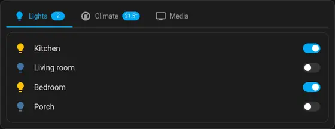
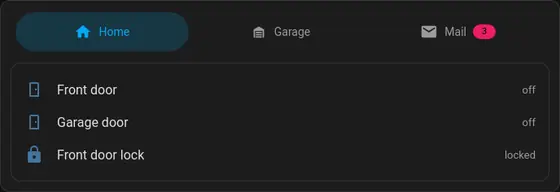
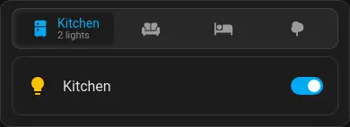
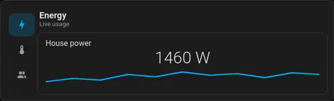

# Gallery

Short clips of Tabdeck in action, recorded from the [live demo](https://tempus2016.github.io/tabdeck-card/demo/) (pretend devices, simplified stand-in cards). Click a title to open that example in the demo and try it yourself.

| | |
|---|---|
| **[Switching tabs](https://tempus2016.github.io/tabdeck-card/demo/#basics)**<br>The indicator slides to the tab you pick.<br> | **[Alerts and live icons](https://tempus2016.github.io/tabdeck-card/demo/#alerts)**<br>The garage door opens: its tab turns red, changes icon and pulses until it closes.<br> |
| **[Swipe between tabs](https://tempus2016.github.io/tabdeck-card/demo/#phone)**<br>`swipe: true` with the `ios` preset on a phone-width deck.<br> | **[Side rail](https://tempus2016.github.io/tabdeck-card/demo/#rail)**<br>`preset: rail` with `rail_expand: true`: the rail opens to show names on hover.<br> |

## Making the clips

The clips are made by a script, so they can be redone after a change to the look:

```sh
npm run build:demo
npx playwright install chromium
node scripts/clips/record-clips.mjs              # all clips → wiki/images/clips/*.webp
node scripts/clips/record-clips.mjs --only swipe --gif
```

It serves the built demo, plays each clip in `scripts/clips/clips.mjs` (clicks, hovers, drags) while recording Chrome's screen, crops to the preview and writes an animated WebP of 10 to 25 kB per clip with `scripts/clips/encode.py` (Python 3 with Pillow). `--gif` also writes a GIF (about four times larger). With a remote Chrome, pass `--cdp <url>` and `--base-url` pointing at a copy of `site/demo/` that Chrome can load. To add a clip, add an entry to `clips.mjs` with the demo page, the element to crop to, and what to do.
