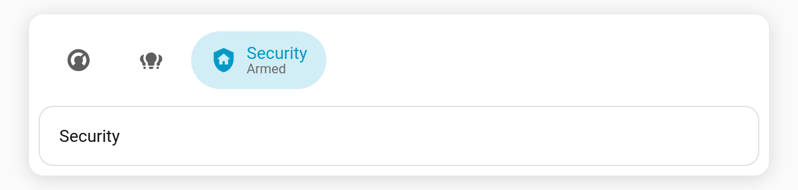
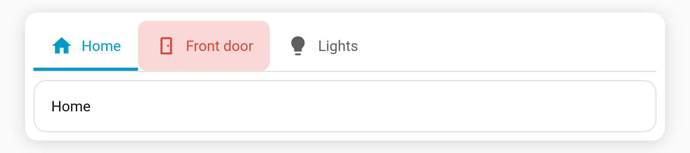
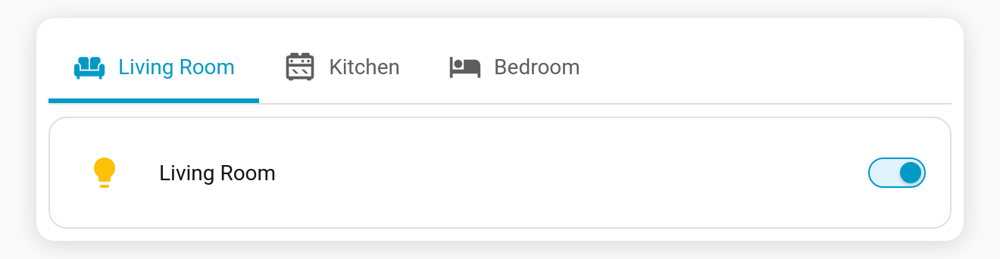

# Showcase

Real decks from Tabdeck users. Copy the ideas you like. Every entry links back to its discussion, where you'll find the full YAML.

> 🙌 **Share yours:** post it in [Show and tell](https://github.com/tempus2016/tabdeck-card/discussions/new?category=show-and-tell). The form asks for a screenshot, a sentence about what it does, and (optionally) the YAML. Ones that are ticked "OK to feature" get added here with credit.
>
> 🎮 Want to experiment first? The [live demo](https://tempus2016.github.io/tabdeck-card/demo/) runs in your browser.

## Community decks

*Be the first! Post yours in [Show and tell](https://github.com/tempus2016/tabdeck-card/discussions/new?category=show-and-tell).*

<!-- Template for new entries:
### <Title> — by @<username>

<One or two sentences: where it's used and what makes it work.> Key options: `…`.
[Discussion & YAML](https://github.com/tempus2016/tabdeck-card/discussions/<n>)
-->

## Starter ideas

Small, copyable patterns to start from (also in the [live demo](https://tempus2016.github.io/tabdeck-card/demo/)).

### Phone: icons, with the selected tab spelled out



Fits many rooms on a phone-width bar. Swipe between them.

```yaml
type: custom:tabdeck-card
preset: ios
tab_display: active
swipe: true
transition: slide
tabs:
  - { name: Kitchen, icon: mdi:fridge, card: { type: tile, entity: light.kitchen } }
  - { name: Living room, icon: mdi:sofa, card: { type: tile, entity: light.living_room } }
  - { name: Bedroom, icon: mdi:bed, card: { type: tile, entity: light.bedroom } }
```

### Alerts that grab attention



The Garage tab turns red, swaps to an open-garage icon and pulses while the door is open.

```yaml
- name: Garage
  icon: "{{ 'mdi:garage-open' if is_state('binary_sensor.garage_door', 'on') else 'mdi:garage' }}"
  color: "{{ 'red' if is_state('binary_sensor.garage_door', 'on') else '' }}"
  alert:
    - { condition: state, entity: binary_sensor.garage_door, state: "on" }
  card: { type: entities, entities: [binary_sensor.garage_door] }
```

### Wall tablet that cycles and comes home


```yaml
type: custom:tabdeck-card
preset: rail
header: true
auto_rotate: { interval: 20, resume_after: 120 }
idle_return: 300
tabs: [ ... ]
```

### A tab per room, no YAML per room



```yaml
type: custom:tabdeck-card
auto_tabs:
  source: areas
  domains: [light, switch, climate]
tabs: []
```

Or click **Start from a template → Rooms** in the editor (see [Starter templates](Feature-Starter-Templates)).
